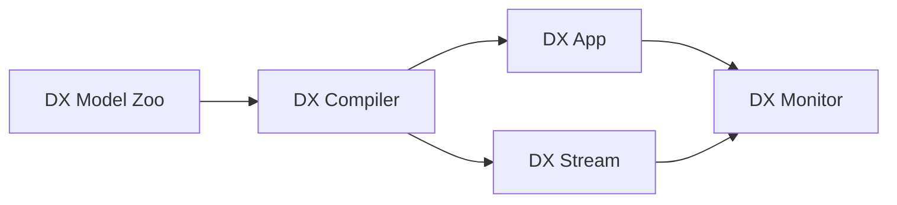

# DX AI Studio

DX AI Studio lets you compile models, run inference, build streaming pipelines and watch the NPU from one browser workspace.

!!! warning "Beta"
    DX AI Studio 0.1.1 is a beta release. Features and the UI can change before the general availability release.

It is a launcher hub plus nine tool servers, written in pure Python (standard library only). You open one address in the browser and every tool runs inside the hub. The studio ships in the DEEPX SDK under `dx-all-suite/dx-ai-studio` and uses the SDK parts next to it (`dx-runtime`, `dx-compiler`) for real compilation and inference. Without an NPU or SDK the studio still opens, and each tool tells you what is missing.

## The nine tools

| Tool | What you do with it | Page |
|---|---|---|
| **DX App** | Run inference on images, video, camera or RTSP; demos, benchmark, A/B compare and Graph Composer | [DX App](app.md) |
| **DX Stream** | Build and run GStreamer pipelines with live playback in the browser | [DX Stream](stream.md) |
| **DX Model Zoo** | Browse 497 model variants across 29 tasks, download artifacts, try inference | [Models and compiler](workflow.md) |
| **DX Compiler** | Compile ONNX to `.dxnn` with a config wizard, quantization tuning and diagnosis | [Models and compiler](workflow.md#dx-compiler) |
| **DX EdgeGuide** | Get a hardware recommendation from real benchmark results | [DX EdgeGuide](edge-guide.md) |
| **DX Benchmark** | Browse and compare stored NPU benchmark results | [Monitor and benchmark](monitor-and-benchmark.md#dx-benchmark) |
| **DX Monitor** | Watch live NPU and host telemetry | [Monitor and benchmark](monitor-and-benchmark.md) |
| **DX Agent Dev** | Describe an app in plain words and let a coding agent build it | [Agent driven development](../tools/agent-driven-development.md#in-dx-ai-studio) |
| **DX Cloud** | Compile on AWS through our AWS Marketplace products | [DX Cloud on AWS](cloud-aws.md) |

The tool names are the labels you see in the studio. DX App runs the DX-APP examples, DX Stream runs DX-Stream pipelines, DX Compiler drives DX-COM and DX Model Zoo shows the DX-ModelZoo catalog.

## Typical workflows

1. **Model to inference:** pick a model in DX Model Zoo, compile it in DX Compiler, run it in DX App or DX Stream, and watch DX Monitor.
1. **Hardware selection:** compare results in DX Benchmark, then ask DX EdgeGuide for a board and host.
1. **Quick development:** describe the app in DX Agent Dev and let a coding agent build it.

## Where to go

* [Install and launch](install-and-launch.md): requirements, `./launcher.sh`, remote access and troubleshooting.
* [The hub](hub.md): home screen, navigation, tutorials, languages and the chat assistant.
* [Models and compiler](workflow.md): DX Model Zoo and DX Compiler.
* [DX App](app.md): inference, demos and Graph Composer.
* [DX Stream](stream.md): GStreamer pipelines in the browser.
* [Monitor and benchmark](monitor-and-benchmark.md): DX Monitor and DX Benchmark.
* [DX EdgeGuide](edge-guide.md): hardware recommendations.
* [DX Cloud on AWS](cloud-aws.md): cloud compile and Greengrass devices.
* [Reference](reference.md): SDK Library, environment variables, ports and third party licenses.
* [Release notes](../release-notes/ai-studio.md): what changed in each version.

## Next steps

* [Install and launch DX AI Studio](install-and-launch.md)
* [Install the DEEPX SDK](../get-started/install.md)
