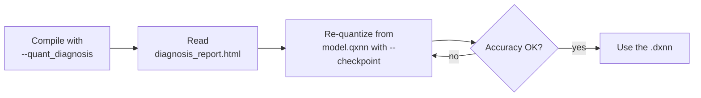

# Quantization

This page lets you get the best INT8 accuracy out of DX-COM: pick a calibration method, use the DXQ enhancement schemes, and diagnose and re-quantize a model without compiling it again.

## Before you start

* A model that already compiles. See [Compile a model](compile-a-model.md).
* A way to measure accuracy of the `.dxnn` against the original model on the same evaluation set.

## Tuning path

DX-COM uses post training quantization (PTQ) by default. When accuracy is not good enough, go down this list and stop when accuracy is acceptable:

| Step | What to try | Where |
|---|---|---|
| 1 | Check the preprocessing: calibration must match inference exactly. | [Config file reference](config-reference.md#default_loader) |
| 2 | Try other `calibration_method` and `calibration_num` values. | [Calibration](#calibration) |
| 3 | Run `--quant_diagnosis`, then re-quantize from the checkpoint. | [Diagnose and re-quantize](#diagnose-and-re-quantize) |
| 4 | Turn on automatic Q-PRO with `--use_q_pro`. | [Automatic Q-PRO](#automatic-q-pro) |
| 5 | Pick a DXQ scheme by hand. | [DXQ schemes](#dxq-schemes) |
| 6 | Train with Q-Master (QAT). Needs a CUDA GPU. | [Q-Master (QAT)](q-master.md) |

## Calibration

Calibration runs your sample images through the model to find the value range of each activation. DX-COM uses these ranges to quantize to INT8.

| Setting | Values | Default |
|---|---|---|
| `calibration_method` | `"ema"` (exponential moving average, recommended), `"minmax"` (min and max values), `"iqr"` (25th to 75th percentile, robust to outliers) | `"ema"` |
| `calibration_num` | Positive integer: number of calibration samples | `100` |

Set them in the JSON config, or as `dx_com.compile()` arguments when you use a `DataLoader`.

Tips:

* Use images that look like your real input. Do not use your test set.
* Provide at least `calibration_num` images. With fewer, DX-COM uses all of them and prints no warning.
* Try `calibration_num` values such as 1, 5, 10, 100 and 1000, and keep the best.
* For non image data, `minmax` can work better.

## Automatic Q-PRO

Q-PRO is our set of quantization enhancement schemes, DXQ-P0 to DXQ-P5. With `--use_q_pro`, DX-COM creates DXQ combinations and picks the best enhancement stages for your model from its structure and compile time metrics. Available from DX-COM 2.4.0.

=== "CLI"
    ```bash
    dxcom -m model.onnx -c config.json -o output/qpro --use_q_pro
    ```

=== "Python"
    ```python
    import dx_com

    dx_com.compile(
        model="model.onnx",
        output_dir="output/qpro",
        config="config.json",
        use_q_pro=True,
    )
    ```

* Do not combine with a manual `enhanced_scheme` or with `qmaster`.
* ONNX compile path and resume mode only.
* Start with `--use_q_pro`. Pick a scheme by hand only when you need one specific scheme.

## DXQ schemes

Set a scheme by hand with the `enhanced_scheme` key. Available from DX-COM 2.1.0.

| Scheme | Compile speed | Accuracy gain | JSON form |
|---|---|---|---|
| DXQ-P0 | Very fast | Low | `{"DXQ-P0": {"alpha": 0.5}}` |
| DXQ-P1 | Very slow | Low to middle | `{"DXQ-P1": true}` |
| DXQ-P2 | Very slow | Middle to high | `{"DXQ-P2": {"alpha": 0.1, "beta": 1.0, "cosim_num": 2}}` |
| DXQ-P3 | Very slow | High | `{"DXQ-P3": {"num_samples": 1024}}` |
| DXQ-P4 | Very slow | High | `{"DXQ-P4": {"num_samples": 1024}}` |
| DXQ-P5 | Very slow | High | `{"DXQ-P5": {"num_samples": 1024}}` |

* DXQ-P0 uses `alpha` to set the strength. DXQ-P2 adds `beta` and `cosim_num`. DXQ-P3 to P5 take an optional `num_samples` (we recommend 1024).
* Try DXQ-P3 and DXQ-P4 first: they usually give the best accuracy.
* P1 to P5 need a lot of compute. Quantizing on a GPU (the default when one is available) is about 2 to 5 times faster than on CPU.
* A better result is not guaranteed. It depends on the model and the dataset.
* Not supported for multi input models.

=== "CLI"
    Put the scheme in the config:

    ```json
    {
      "enhanced_scheme": {
        "DXQ-P3": {"num_samples": 1024}
      }
    }
    ```

    ```bash
    dxcom -m model.onnx -c config.json -o output/dxq
    ```

=== "Python"
    ```python
    import dx_com

    dx_com.compile(
        model="model.onnx",
        output_dir="output/dxq",
        config="config.json",
        enhanced_scheme={"DXQ-P3": {"num_samples": 1024}},
    )
    ```

## Choose CPU or GPU

Quantization runs on a CUDA GPU when one is available, and on CPU otherwise.

| Goal | CLI | Python |
|---|---|---|
| GPU when available (default) | `--use_gpu True` | `use_gpu=True` |
| Force CPU | `--use_gpu False` | `use_gpu=False` |
| Use a specific GPU | `CUDA_VISIBLE_DEVICES=1 dxcom ...` | `CUDA_VISIBLE_DEVICES=1 python compile.py` |

GPU quantization needs an NVIDIA GPU with CUDA and a CUDA build of PyTorch (`torch.cuda.is_available()` returns `True`). The JSON key `quantization_device` is ignored since 2.5.0.

## Diagnose and re-quantize

Changing a quantization setting normally means compiling again from ONNX, which is slow. DX-COM 2.4.0 and later has a faster loop:



### 1. Compile with diagnosis

=== "CLI"
    ```bash
    dxcom -m large_model.onnx -c config.json -o output/large_model --quant_diagnosis
    ```

=== "Python"
    ```python
    import dx_com

    dx_com.compile(
        model="large_model.onnx",
        output_dir="output/large_model",
        config="config.json",
        quant_diagnosis=True,
    )
    ```

This writes a `quant_diagnosis/` folder in the output directory:

| File | Description |
|---|---|
| `quant_diagnosis/<model>.qxnn` | Resume checkpoint. Always written when diagnosis runs. |
| `quant_diagnosis/diagnosis_report.html` | Quality report per region with retry snippets. Written when diagnosis succeeds. |

### 2. Read the report

A region is a quantization block: a group of operations that DX-COM quantizes and evaluates together. The report grades each region as OK, Warning or Critical, using cosine similarity and QSNR measured on that region alone. Region results may not fully match the behavior of the whole deployed model.

| Report part | What it shows |
|---|---|
| Model Status | The overall verdict (OK, Warning or Critical), from the worse of the whole model cosine similarity and QSNR, with the thresholds. |
| Candidate Recompile Intents | Suggested next steps in priority order (for example a DXQ scheme or another calibration method), each with ready to paste Python and `dxcom` snippets for the `.qxnn` checkpoint. Candidates such as DXQ-P3, P4 and P5 are alternatives: pick one. |
| Evidence Summary | Collapsible. How many regions are in each severity level, and weight and activation quantization details. |

### 3. Re-quantize from the checkpoint

Resume mode re-runs only the steps that depend on quantization. You do not need the ONNX model or the config: the calibration settings are stored in the checkpoint. Run one option at a time.

=== "CLI"
    ```bash
    # Option A: another calibration method
    dxcom \
      --checkpoint output/large_model/quant_diagnosis/large_model.qxnn \
      -o output/large_model_iqr \
      --recalibration_method iqr

    # Option B: automatic Q-PRO
    dxcom \
      --checkpoint output/large_model/quant_diagnosis/large_model.qxnn \
      -o output/large_model_qpro \
      --use_q_pro
    ```

=== "Python"
    ```python
    import dx_com

    ckpt = "output/large_model/quant_diagnosis/large_model.qxnn"

    # Option A: another calibration method
    dx_com.compile(checkpoint=ckpt, output_dir="output/large_model_iqr",
                   recalibration_method="iqr")

    # Option B: automatic Q-PRO
    dx_com.compile(checkpoint=ckpt, output_dir="output/large_model_qpro",
                   use_q_pro=True)
    ```

Resume only options:

| CLI option | Python argument | Description |
|---|---|---|
| `--checkpoint` | `checkpoint` | Path to the `.qxnn` file. Selects resume mode. |
| `--recalibration_method` | `recalibration_method` | `minmax`, `ema` or `iqr`. |
| `--enhanced_scheme` | `enhanced_scheme` | Manual DXQ scheme, for example `P3:num_samples=1024` on the CLI. |
| `--dataset_path` | `dataset_path` | Another calibration dataset than the one stored in the checkpoint. |

Rules:

* `--checkpoint` and `-m` cannot be used together. `-o` is required. `-c` is not needed.
* `--use_q_pro` and `--enhanced_scheme` cannot be used together.
* Resume only options without `--checkpoint` raise an error.
* The checkpoint extension must be `.qxnn` (any case). Other extensions raise `ValueError`.
* On resume, DX-COM rebuilds the calibration loader from the config stored in the checkpoint (default loader only).
* Resume writes `<checkpoint_stem>.dxnn` to the output directory.

!!! note "Two different .qxnn files"
    The `qat_checkpoint.qxnn` that Q-Master writes is not a resume checkpoint. Pass it only to `QMasterConfig(resume_from_checkpoint=...)`, never to `--checkpoint`.

## Next steps

* [Q-Master (QAT)](q-master.md)
* [Use cases](use-cases.md)
* [Troubleshooting](troubleshooting.md)
