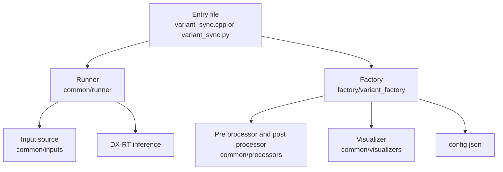

# DX-APP architecture

This page explains how the DX-APP repository is organized and how each example is put together, so you can read, change or extend the code.

## Repository layout

```text
dx_app/
├── src/
│   ├── cpp_example/            # C++ examples: <task>/<family>/<variant>/
│   │   ├── multi_model_graph/  # Graph CLI and sample graph JSON files
│   │   └── common/             # Shared C++ runtime layer
│   ├── python_example/         # Python examples: <task>/<family>/<variant>/
│   │   └── common/             # Shared Python runtime layer
│   ├── postprocess/            # C++ post processing used by the Python bindings
│   ├── utility/                # Support code for the build
│   └── bindings/python/
│       ├── dx_postprocess/     # pybind11 module wrapping src/postprocess/
│       └── dx_graph/           # pybind11 module running multi model graphs
├── config/
│   ├── model_registry.json     # Model registry: one row per variant
│   └── test_models.conf        # Variant to model file map for runners and benchmarks
├── scripts/                    # Developer tools (dx_tool.sh, add_model.sh, ...)
├── tests/                      # pytest suites (cpp_example, python_example, scripts)
├── sample/                     # Bundled sample images, galleries, KITTI data
├── assets/                     # Downloaded models and videos (setup.sh)
├── build.sh, build.bat         # Build scripts
├── install.sh                  # Dependency installer
├── setup.sh, setup.bat         # Model and video downloader
├── run_demo.sh, run_demo.bat   # Interactive demo
├── run_multi_model_demo.sh     # Graph demo and checker
└── run_tc.sh                   # Test runner
```

Both example trees are organized by **task**, then **model family**, then **variant**. The variant is the `.dxnn` file stem, and it names the folder, the entry files, the build targets and the model file. There are 29 task folders, for example `image_classification`, `object_detection` (PPU models are the family `yolo_ppu`), `face_detection`, `pose_estimation`, `semantic_segmentation`, `instance_segmentation`, `depth_estimation`, `super_resolution` and `person_reid`. The [model catalog](models.md) lists all of them.

## How an example is built

Every variant folder is thin: an entry file and a factory. The heavy work lives in the shared `common/` layer of its language.



| Layer | C++ | Python |
| --- | --- | --- |
| App (entry point) | `<variant>_sync.cpp` | `<variant>_sync.py` |
| Runner (sync or async pipeline) | `sync_detection_runner.hpp` | `sync_runner.py` |
| Factory (assembles the parts for one model) | `<variant>_factory.hpp` | `<variant>_factory.py` |
| Components | `processors/*.hpp`, `visualizers/*.hpp` | `processors/*.py`, `visualizers/*.py` |
| Interfaces | `i_factory.hpp`, `i_processor.hpp` | `i_factory.py`, `i_processor.py` |

### Variant folders

=== "Python"

    ```text
    src/python_example/object_detection/yolov8/yolov8-n_640x640/
    ├── factory/
    │   └── yolov8-n_640x640_factory.py
    ├── config.json
    ├── yolov8-n_640x640_sync.py
    ├── yolov8-n_640x640_async.py
    ├── yolov8-n_640x640_sync_cpp_postprocess.py
    └── yolov8-n_640x640_async_cpp_postprocess.py
    ```

=== "C++"

    ```text
    src/cpp_example/object_detection/yolov8/yolov8-n_640x640/
    ├── factory/
    │   └── yolov8-n_640x640_factory.hpp
    ├── yolov8-n_640x640_sync.cpp      # builds bin/yolov8-n_640x640_sync
    ├── yolov8-n_640x640_async.cpp     # builds bin/yolov8-n_640x640_async
    └── config.json
    ```

### Entry files

The entry file creates the factory and hands it to a runner.

=== "Python"

    ```python
    from factory import Yolov9Factory
    from common.runner import SyncRunner
    from common.runner.entry import run_entry

    run_entry(_script, factory_cls=Yolov9Factory, runner_cls=SyncRunner,
              description="yolov9-s_640x640 sync inference",
              fixed_variant="yolov9-s_640x640")
    ```

=== "C++"

    ```cpp
    // object_detection/yolov9/yolov9-s_640x640/yolov9-s_640x640_sync.cpp
    auto factory = std::make_unique<dxapp::v_yolov9_s_640x640::Yolov9Factory>();
    dxapp::SyncDetectionRunner<dxapp::v_yolov9_s_640x640::Yolov9Factory> runner(std::move(factory));
    return runner.run(argc, argv);
    ```

Each C++ factory lives in the namespace `dxapp::v_<variant>`.

### Factories

A factory implements the task interface (for example `IDetectionFactory`) and creates the pre processor, post processor and visualizer.

* **Python factories are config driven.** Every variant folder of a family has the same factory class. It builds its processor classes and their arguments from the `preprocessor`, `postprocessor` and `visualizer` entries in the folder's `config.json`. For `yolov9-s_640x640`:

    ```json
    "preprocessor":  { "class": "LetterboxPreprocessor", ... },
    "postprocessor": { "class": "YOLOv8Postprocessor", ... },
    "visualizer":    { "class": "DetectionVisualizer", ... }
    ```

* **C++ factories are code.** They include the shared headers they need, for example `common/processors/yolo_detection_postprocessor.hpp` and `common/visualizers/detection_visualizer.hpp`, and read thresholds from `config.json` only when you pass `--config`.

### Runners

| | C++ (`cpp_example/common/runner/`) | Python (`python_example/common/runner/`) |
| --- | --- | --- |
| Runner set | One sync and one async runner per task type, for example `sync_detection_runner.hpp` and `async_detection_runner.hpp` | Generic `SyncRunner` and `AsyncRunner` for every task |
| Dispatch | A task specific runner per category | The factory supplies the task specific parts |

## The common layers

Both `common/` folders have the same core modules.

| Module | Role |
| --- | --- |
| `base/` | Interfaces: the task factories (`IDetectionFactory`, `IClassificationFactory`, ...), `IPreprocessor` and `IPostprocessor`, `IVisualizer`, `IInputSource` |
| `config/` | Loads `config.json` (`model_config.hpp`; Python `model_config.py`, `config_schema.py`) |
| `processors/` | Shared pre and post processors for all model families |
| `runner/` | The sync and async runners. Python also has `args.py` (the command line), `entry.py` (`run_entry()`), `interrupts.py` (Ctrl+C), `run_dir.py` (`--save`), `sr_tiling.py` and `verify_serialize.py` |
| `inputs/` | Image, video, camera and RTSP sources, and `input_factory` |
| `visualizers/` | Task specific drawing |
| `utility/` | Labels, pre processing helpers, profiling, run folders, colorspace, verification output |
| `trackers/` | IoU tracker (keeps instance colors stable across frames) |

C++ only: `graph/` (the multi model graph engine), `registry/` (the model registry the graph engine uses), `test/` (unit tests of `common/`) and `third_party/` (`nlohmann_json.hpp`). Python only: `variant_config.py` (builds processors from `config.json`) and `variants.py` (resolves a variant through `config/model_registry.json`).

Python examples find `common/` themselves: each entry script walks up its folders until it finds `common/runner/entry.py`, so you can run it from any folder without setting `PYTHONPATH`.

## Configuration

### config.json

Each variant folder has a `config.json` with its runtime settings: thresholds, top-k, input size, labels and the default sample image. Settings apply in this order, later wins:

```text
factory defaults  <  <task>/<family>/<variant>/config.json  <  --config file
```

* Python reads the variant's `config.json` automatically and accepts the alias `score_threshold` for `conf_threshold`.
* C++ reads a config file only when you pass `--config <path>`. Without it, the defaults compiled into the factory apply.

### Model registry

`config/model_registry.json` is a JSON array with one row per variant. It is the single source of truth for model metadata. A row:

```json
{
  "model_name": "yolov8n",
  "dxnn_file": "yolov8-n_640x640.dxnn",
  "original_name": "YoloV8N",
  "add_model_task": "object_detection",
  "postprocessor": "yolov8",
  "input_width": 640,
  "input_height": 640,
  "config": { "score_threshold": 0.25, "nms_threshold": 0.45 },
  "supported": true,
  "variant": "yolov8-n_640x640",
  "family": "yolov8",
  "task": "object_detection",
  "image_only": false,
  "alias_of": null,
  "published": true
}
```

| Field | Meaning |
| --- | --- |
| `variant` | The model identity: the `.dxnn` stem and the example folder name |
| `family`, `task` | The family and task folders |
| `model_name` | The row name: the variant, or the variant's old name, which still resolves to it |
| `dxnn_file` | File name in `assets/models/`; the case must match exactly |
| `original_name` | The Model Zoo display name |
| `input_width`, `input_height` | The input size of the compiled `.dxnn` (width first) |
| `config` | Runtime parameters (thresholds, `num_classes`, ...) |
| `postprocessor` | The `--postprocessor` value for `add_model.sh` |
| `add_model_task` | The task value for `add_model.sh` and the validation scripts (older task names such as `classification` and `ppu`) |
| `supported` | `false` skips the model in validation (add `failure_reason`) |
| `image_only` | `true` when the examples take `--image` only |
| `alias_of` | `null`, or the row this row aliases |
| `published` | `true` when the Model Zoo publishes the `.dxnn` |

Other fields (`csv_task`, `task_legacy`, `zoo_canonical`, `source`) are bookkeeping. The registry is read by the runners (the default model when `-m` is left out), the downloader (`setup.sh --models`), the graph registry generator (run by the CMake configure step), and the tests. `python3 scripts/check_model_registry.py` checks that the rows and the example folders agree.

`config/test_models.conf` is generated from the registry with `python3 scripts/regen_test_models_conf.py`. Each tab separated line maps a variant to its family, task and model file, for `run_examples.sh` and `bench_models.sh`:

```text
# family<TAB>task<TAB>model_file<TAB>variant
yolov8	object_detection	assets/models/yolov8-n_640x640.dxnn	yolov8-n_640x640
```

## Add an example

Most new models need no new code: `scripts/add_model.sh` copies a reference variant of the same family and registers the new one (see [DX tool](dx-tool.md)). When you add an example by hand, follow these rules:

1. Pick the right task folder, and create `<task>/<family>/<variant>/` in both trees.
1. Name the folder and files after the variant, following the existing pattern.
1. Put shared decoding in `src/cpp_example/common/processors/` (C++) or `src/python_example/common/processors/` (Python).
1. Add a `src/postprocess/` module and a `dx_postprocess` binding only if you want `*_cpp_postprocess.py` variants.
1. Register the variant in `config/model_registry.json`, regenerate `test_models.conf`, and run `bash scripts/ci_checks.sh`.
1. Check that the tests discover it: the C++ tests discover executables in `bin/`, the Python tests discover scripts through `tests/test_helpers/utils.py` and the registry. A new folder alone does not guarantee test coverage.

## Next steps

* [DX tool](dx-tool.md): add and validate examples.
* [Post processing](post-processing.md): the C++ library and Python bindings.
* [Customize a YOLO model](customize-yolo.md)
