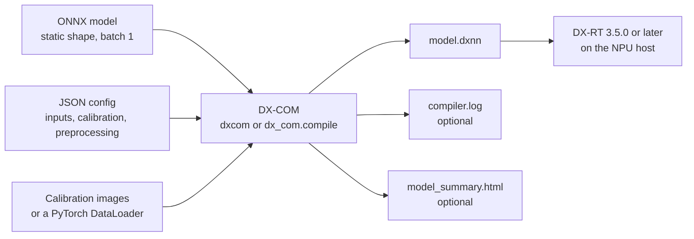

# DX-COM compiler

DX-COM is our compiler: it turns a trained ONNX model into a `.dxnn` file that runs on a DEEPX NPU.
It quantizes the model to INT8 with your calibration images, optimizes the graph, splits it between NPU and CPU, and writes one binary.
You use it from the `dxcom` command line tool or from the `dx_com` Python module (pip package `dx-com`).

Current version: DX-COM 2.5.0 (DEEPX SDK 2.5.0).

## How it works

| Item | What it is |
|---|---|
| Input: ONNX model | Your trained model, exported with opset 11 to 21, batch size 1 and static input shape. See [Prepare an ONNX model](onnx-models.md). |
| Input: JSON config | Input name and shape, calibration settings and the preprocessing chain. See [Config file reference](config-reference.md). |
| Input: calibration data | A folder of representative images (about 100), or a PyTorch `DataLoader` in Python. |
| Output: `.dxnn` | The compiled model, `.dxnn` file format v9. It needs DX-RT 3.5.0 or later. DX-RT 3.4.2 and earlier cannot load it. |
| Output: `compiler.log` | Full log, written with `--gen_log`. |
| Output: `<model_name>_summary.html` | Compilation summary report, written with `--export_html`. See [Summary report](summary-report.md). |

Good to know:

* You do not need a DEEPX NPU, its driver or DX-RT to compile. DX-COM runs on any supported x86_64 Linux host.
* DX-COM has a CLI and a Python API. There is no C++ compiler API. To run the `.dxnn` from Python or C++, use DX-RT: see [DX-RT](../runtime/index.md).
* A GPU is optional for normal compiling (it speeds up quantization). Q-Master training needs a CUDA GPU.

## System requirements

Install DX-COM: see [Install](../get-started/install.md). This table is the reference for the host that runs the compiler.

| Item | Requirement |
|---|---|
| CPU | x86_64 (amd64). aarch64 (arm64) is not supported. |
| OS | Ubuntu 20.04, 22.04, 24.04, 26.04; Fedora 42 to 45; Red Hat Enterprise Linux 9 to 10; CentOS Stream 9 to 10. Ubuntu 18.04 is not supported. |
| glibc | 2.31 or newer (the wheels are tagged `manylinux_2_31_x86_64`). Check with `ldd --version`. |
| Python | 3.8, 3.9, 3.10, 3.11, 3.12, 3.13, 3.14 |
| RAM | 16 GB or more |
| Disk | 8 GB or more free |
| System libraries | OpenGL and GLib runtime: `libgl1` and `libglib2.0-0` (Debian, Ubuntu) or `mesa-libGL` and `glib2` (Fedora, RHEL, CentOS). Without them DX-COM raises `RequiredLibraryError`. |
| GPU (optional) | NVIDIA GPU with CUDA and a CUDA build of PyTorch (`torch.cuda.is_available()` returns `True`). |
| NPU | Not needed to compile. |

!!! note
    Compiled results can vary slightly with the host environment (CPU architecture, OS and other hardware factors). Use `--float64_calibration` when you need the same result on different CPUs.

## Where to go

* [Compile a model](compile-a-model.md): run `dxcom`, every CLI option, sample models.
* [Python API](python-api.md): `dx_com.compile()` parameters, DataLoader, `PPUConfig`, `QMasterConfig`.
* [Config file reference](config-reference.md): every JSON key with a complete working example.
* [Prepare an ONNX model](onnx-models.md): export from PyTorch and the supported ONNX operators.
* [Quantization](quantization.md): calibration, DXQ and Q-PRO, diagnosis and resume.
* [Q-Master (QAT)](q-master.md): quantization aware training when PTQ is not accurate enough.
* [PPU for YOLO models](ppu.md): on NPU post processing for detection models.
* [Pre Optimize API](pre-optimize.md): faster CPU post processing for YOLO and RTMDet.
* [Use cases](use-cases.md): complete examples for common tasks.
* [Summary report](summary-report.md): the HTML report that replaces DX-TRON.
* [Troubleshooting](troubleshooting.md): error types and fixes.

## Next steps

* [Install](../get-started/install.md)
* [Compile a model](compile-a-model.md)
* [Quickstart](../get-started/quickstart.md)
