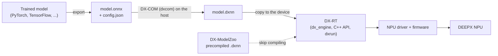

# Get started

This section shows you what the DEEPX SDK contains and takes you from an empty machine to your first model running on a DEEPX NPU.

The DEEPX SDK is our complete, version aligned release of tools for DEEPX NPUs (also called DX-AllSuite or DXNN SDK in older material). The current release is DEEPX SDK 2.5.0. You use it on two kinds of machines:

* a **host**: an x86_64 Linux PC where you compile models with DX-COM. It does not need an NPU.
* a **device**: an x86_64 or aarch64 machine with a DEEPX NPU (DX-M1, DX-M1M or DX-H1 Quattro) where you run compiled models with DX-RT.

One machine can be both, for example an x86_64 PC with a DX-M1 M.2 module.

## What the SDK is made of

| Component | Runs on | What it does |
|---|---|---|
| DX-COM | Host (x86_64 only) | Compiles and quantizes an ONNX model into a `.dxnn` file. CLI `dxcom`, Python module `dx_com`, pip package `dx-com`. |
| DX-RT | Device | Loads `.dxnn` files and runs inference on the NPU. C/C++ API, Python package `dx_engine`, CLI tools `dxcli`, `dxrun`, `dxparse`, `dxtop`, service `dxrtd`. |
| NPU driver | Device | Linux kernel modules (`dxrt_driver`, `dx_dma`) that talk to the NPU over PCIe. Debian package `dxrt-driver-dkms`. |
| Firmware | Device (on the NPU) | Code that runs on the NPU card itself. You update it with `dxcli -u`. |
| DX-APP | Device | Ready to run C++ and Python example applications for vision tasks. |
| DX-Stream | Device | GStreamer plugins that put NPU inference into video pipelines. |
| DX-ModelZoo | Host or device | Pre-trained models with configs and precompiled `.dxnn` files, plus the `dxmz` CLI to evaluate and compile them. |
| DX AI Studio | Host or device | Browser workspace that puts model zoo, compiler, apps, streams, benchmarks and NPU monitoring in one place. |

For the exact version of each component in this release, see [Compatibility](compatibility.md).

## How a model reaches the NPU

| Step | Where | What you do | Tool |
|---|---|---|---|
| 1. Prepare | Your training setup | Export the model to ONNX (opset 11 to 21, 17 recommended, fixed input size). Write a JSON config with input and calibration settings. | PyTorch, TensorFlow, Ultralytics |
| 2. Compile | Host | Turn the ONNX file into a `.dxnn` file with INT8 quantization. | `dxcom` or `dx_com.compile()` |
| 3. Deploy | Device | Copy the `.dxnn` file to the device. | `scp`, shared folder |
| 4. Run | Device | Load the model and run inference from Python or C++, or inside a GStreamer pipeline. | DX-RT, DX-APP, DX-Stream |

If you only want to try the NPU, skip steps 1 and 2 and use a precompiled model from DX-ModelZoo.

## Where to go

1. [Install](install.md): install the NPU driver, DX-RT and firmware on the device, and DX-COM on the host.
1. [Quickstart](quickstart.md): compile one model and run it in Python or C++.
1. [Compatibility](compatibility.md): version matrix, supported OS, Python and hardware, and how to check what you have.
1. [Troubleshooting](troubleshooting.md): fixes for common install and environment errors.

For words and old product names you meet in our material, see the [Glossary](../reference/glossary.md).

## Next steps

* [Install the SDK](install.md)
* [Run your first model](quickstart.md)
* [DX-COM overview](../compiler/index.md)
* [DX-RT overview](../runtime/index.md)
