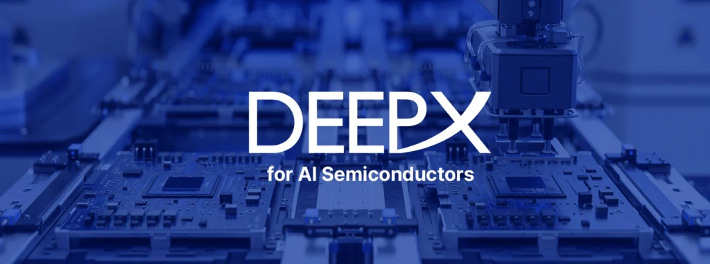
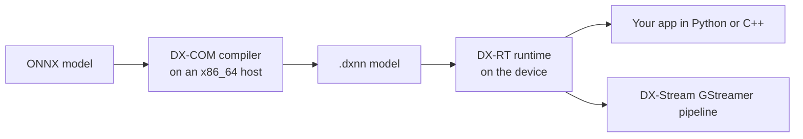

# DEEPX Tech Docs

These docs show you how to take a trained model, compile it for our NPU and run it in your application.

## Start here

| If you want to | Read |
|---|---|
| Understand how the pieces fit together | [Overview](get-started/index.md) |
| Install the SDK on your host and your device | [Install](get-started/install.md) |
| Compile and run your first model | [Quickstart](get-started/quickstart.md) |
| Check which versions work together | [Compatibility](get-started/compatibility.md) |
| Fix a common problem | [Troubleshooting](get-started/troubleshooting.md) |

## How it works

## Tools

- :material-cog: **DX-COM**

    ---

    Compiles ONNX models into `.dxnn` files for the NPU with INT8 quantization.

    [:octicons-arrow-right-24: Compiler](compiler/index.md)

- :material-lightning-bolt: **DX-RT**

    ---

    Runs `.dxnn` models on the NPU with Python and C++ APIs.

    [:octicons-arrow-right-24: Runtime](runtime/index.md)

- :material-application: **DX-APP**

    ---

    Ready to run example applications for hundreds of vision models.

    [:octicons-arrow-right-24: App](app/index.md)

- :material-video-input-component: **DX-Stream**

    ---

    GStreamer elements for real-time video inference pipelines on the NPU.

    [:octicons-arrow-right-24: Stream](stream/index.md)

- :material-database: **DX-ModelZoo**

    ---

    Pretrained models you can compile, run and evaluate out of the box.

    [:octicons-arrow-right-24: Model Zoo](model-zoo/index.md)

- :material-monitor-dashboard: **DX AI Studio**

    ---

    A desktop app that runs the whole workflow from one window.

    [:octicons-arrow-right-24: AI Studio](ai-studio/index.md)

- :material-tools: **More tools**

    ---

    Benchmark, Kubernetes, DX-Edge and agent driven development.

    [:octicons-arrow-right-24: Tools](tools/index.md)

## Current release

DEEPX SDK 2.5.0, released on 23 October 2026.
| Component | Version in DEEPX SDK 2.5.0 |
|---|---|
| DX-COM (compiler) | 2.5.0 |
| DX-RT (runtime) | 3.5.0 |
| DX-APP (application examples) | 3.3.0 |
| DX-Stream (GStreamer plugins) | 3.2.0 |
| NPU driver | 2.7.0 |
| Firmware | 2.7.6 |
| DX-ModelZoo | 1.0.0 |
| DX AI Studio | 0.1.1 |

See the [compatibility page](get-started/compatibility.md) for the full version matrix.

## Next steps

* [Install the SDK](get-started/install.md)
* [Run your first model](get-started/quickstart.md)
* [Help us improve these docs](contributing/index.md)
