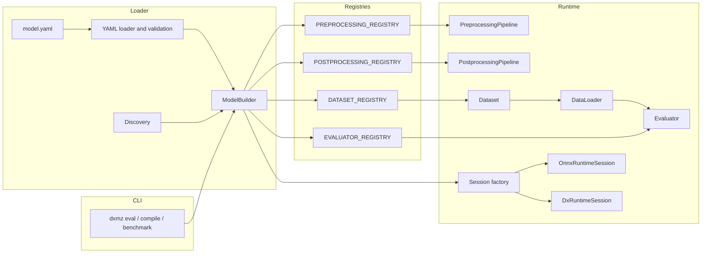
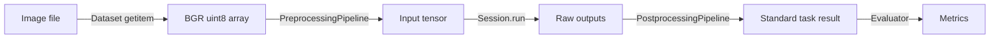
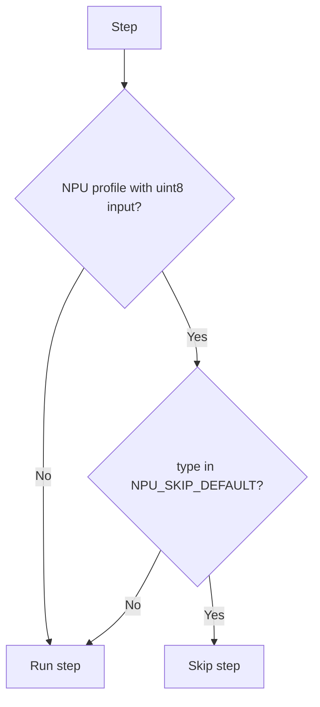

# Architecture

This page explains how DX-ModelZoo turns a model YAML file into running components, so you know where to extend it.

## Components



| Part | Role |
|---|---|
| Discovery | Finds model YAMLs under the built in `models/` folder and the workspace `./custom` folder. A custom model replaces a built in model of the same name. |
| YAML loader | Reads the file, replaces `${VAR}` values and validates the structure. |
| `ModelBuilder` | Imports `custom_ops.py`, then builds the session, dataset, pipelines and evaluator for a profile. |
| Registries | Map each YAML `type` string to a Python class. |
| Session | Runs inference with ONNX Runtime or DX-RT (`dx_engine`). |
| Evaluator | Feeds the data, runs inference and postprocessing, and computes metrics. |

## Design rules

* **One YAML per model.** Preprocessing, postprocessing, dataset and profiles are all in the YAML file. Built in types need no Python code.
* **Postprocessing decodes, the evaluator measures.** Postprocessing turns raw tensors into a standard task format (boxes, keypoints, masks). The evaluator only computes metrics from that format. Model specific decoding belongs in `custom_ops.py`. Shared operations such as NMS and TopK stay in the `postprocessing` package.

## Registries

Four registries hold every extensible part:

| Registry | Import from | Examples |
|---|---|---|
| `PREPROCESSING_REGISTRY` | `dx_modelzoo.preprocessing` | `resize`, `normalize`, `div` |
| `POSTPROCESSING_REGISTRY` | `dx_modelzoo.postprocessing` | `topk`, `nms`, `identity` |
| `DATASET_REGISTRY` | `dx_modelzoo.dataset` | `ILSVRC2012`, `COCO` |
| `EVALUATOR_REGISTRY` | `dx_modelzoo.evaluator` | `image_classification`, `object_detection` |

When `ModelBuilder` reads a step such as `{type: resize, size: [256, 256]}`, it looks up `resize` in the registry and creates the class with the other keys as arguments: `Resize(size=[256, 256])`.

```python
from dx_modelzoo.preprocessing import PREPROCESSING_REGISTRY

@PREPROCESSING_REGISTRY.register("my_op")      # explicit name
class MyOp:
    def __init__(self, param1: int = 10):
        self.param1 = param1

    def __call__(self, data):
        return data

print(PREPROCESSING_REGISTRY.list())
```

`@REGISTRY.register` without a name registers the class under a name derived from the class name. `get()` raises `KeyError` for an unknown name.

### Automatic import of `custom_ops.py`

When `ModelBuilder` loads a YAML file, it imports `custom_ops.py` from the same folder if the file exists. This happens before validation, so types registered there are known.

* The module name includes a SHA1 hash of the file path, so two models can each have a `custom_ops.py`.
* A file that is already imported is not imported again.

## Data flow



| Stage | Component | Data |
|---|---|---|
| Load | Dataset | BGR `np.ndarray` (H, W, 3) |
| Preprocessing | `PreprocessingPipeline` | For example float32 (1, C, H, W) |
| Inference | Session | `list[np.ndarray]` raw outputs |
| Postprocessing | `PostprocessingPipeline` and `custom_ops.py` | Task specific format |
| Evaluation | Evaluator | Metrics dict |

For each batch the evaluator calls, in order: `extract_inputs`, inference, postprocessing, `process_batch_result`. After the last batch it calls `compute_final_metrics`.

## NPU preprocessing skip

For a profile with `target: dxnn`, arithmetic preprocessing is skipped when the compiled model takes `uint8` input, because the compiled model does it on the NPU. The skipped types are in `NPU_SKIP_DEFAULT`:

```python
NPU_SKIP_DEFAULT = {"div", "normalize", "transpose", "expanddim", "mul", "add", "subtract"}
```

| Case | Arithmetic steps |
|---|---|
| `target: onnx` | Run |
| `target: dxnn`, model input `uint8` | Skipped |
| `target: dxnn`, model input `float32` | Run |
| `appendix.npu_skip_arithmetic` set | `false` always runs them, `true` skips them |

Spatial steps (`resize`, `centercrop`, `convertcolor`) always run on the CPU. On the NPU, `bgr_to_y_channel` is replaced by `bgr_to_y_channel_uint8`. Custom operations are never skipped. Postprocessing has no NPU skip.



## Compilation flow

`dxmz compile` builds a calibration data loader from the YAML dataset and the full preprocessing (without `expanddim`), then calls `dx_com.compile()` with every key of the profile's `compile` block. The output is `<onnx name>_<profile>.dxnn` next to the ONNX file, or in the folder given by `--output`.

## Source layout

```text
src/dx_modelzoo/
├── main.py           # dxmz CLI (Typer)
├── command/          # compile, benchmark, create
├── common/           # DataLoader, registry, seed, paths
├── preprocessing/    # preprocessing operations and pipeline
├── postprocessing/   # shared postprocessing operations
├── evaluator/        # task evaluators
├── dataset/          # dataset classes
├── loader/           # YAML loader, ModelBuilder, discovery, scaffold
├── session/          # ONNX Runtime and DX-RT sessions, factory, runtime config
├── models/           # 497 model YAMLs (cv, ppu, pre_optimize)
└── tui/              # interactive model browser and create wizard
```

## Next steps

* [Python API](python-api.md)
* [Custom models and datasets](custom-models.md)
* [Preprocessing and postprocessing](processing-ops.md)
