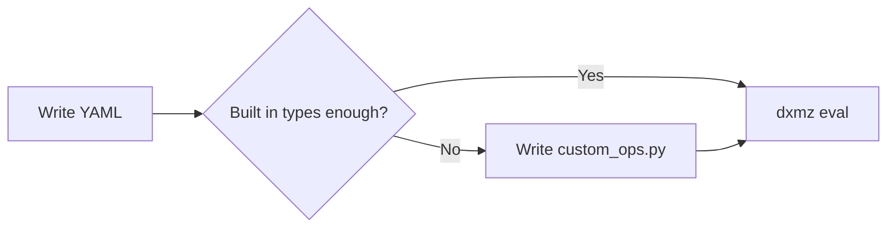

# Custom models and datasets

This page shows how to add your own model to DX-ModelZoo with a YAML file and, when the built in types are not enough, your own operations, dataset or evaluator.

## Before you start

* DX-ModelZoo installed from source, see [Install DX-ModelZoo](install.md).
* Your model as an ONNX file.
* You know the [YAML configuration](yaml-config.md) keys.



## Step 1: create the YAML file

### Option A: use the wizard

```bash
dxmz create
```

`dxmz create` asks for the model name, domain, task, input shape, dataset and profiles, then writes a scaffold to `./custom/<domain>/<task>/<family>/<model>.yaml` in the current folder. It can also create a `custom_ops.py` next to it. It needs an interactive terminal. Review and edit the generated YAML before you use it.

### Option B: write it by hand

Put the file in `./custom/<domain>/<task>/<family>/<ModelName>.yaml` in the folder where you run `dxmz`. `dxmz list`, `info`, `eval` and `compile` then find it by name. You can also pass any YAML path directly, for example `dxmz eval ./my_models/MyModel_v1.yaml --profile onnx`.

A minimal classification model:

```yaml
name: MyModel_v1
task: image_classification
inputs:
  - name: input
    shape: [1, 3, 224, 224]
    dtype: float32
preprocessing:
  - type: resize
    size: [224, 224]
  - type: div
    x: 255
  - type: transpose
    axis: [2, 0, 1]
  - type: expanddim
    axis: 0
postprocessing:
  - type: topk
    k: [1, 5]
evaluator:
  type: image_classification
dataset:
  type: ILSVRC2012
  eval_path: ${DATA_ROOT}/ILSVRC2012/val
artifacts:
  path: ${MODEL_ROOT}/${MODEL_NAME}
calibration: &calibration
  method: ema
  num: 100
  seed: 42
profiles:
  onnx:
    target: onnx
    runtime:
      device: gpu
      batch_size: 1
  q-lite:
    target: dxnn
    compile:
      calibration: *calibration
    runtime:
      device: 0
```

Rules for custom models:

* `name` must be unique among your custom models. A custom model with the same name as a built in model replaces it, and `dxmz` prints a warning.
* Models under `./custom` must set `evaluator.type`. Built in models take it from `task`.
* Place the ONNX file at `${MODEL_ROOT}/MyModel_v1/MyModel_v1.onnx`, or pass `--model-path`.

## Step 2: add custom operations (optional)

When the built in operations are not enough, create `custom_ops.py` in the same folder as the YAML file. `ModelBuilder` imports it automatically before it validates the YAML, so every class you register there can be used as a `type`.

```python
import cv2
import numpy as np
from dx_modelzoo.preprocessing import PREPROCESSING_REGISTRY
from dx_modelzoo.postprocessing import POSTPROCESSING_REGISTRY


@PREPROCESSING_REGISTRY.register("my_letterbox")
class MyLetterbox:
    """Resize with preserved aspect ratio and padding."""

    def __init__(self, target_size, pad_value=114):
        self.target_size = tuple(target_size)  # (H, W)
        self.pad_value = pad_value

    def __call__(self, img: np.ndarray) -> np.ndarray:
        h, w = img.shape[:2]
        th, tw = self.target_size
        scale = min(tw / w, th / h)
        new_w, new_h = int(w * scale), int(h * scale)
        resized = cv2.resize(img, (new_w, new_h))
        canvas = np.full((th, tw, 3), self.pad_value, dtype=np.uint8)
        top, left = (th - new_h) // 2, (tw - new_w) // 2
        canvas[top:top + new_h, left:left + new_w] = resized
        return canvas


@POSTPROCESSING_REGISTRY.register("my_decode")
class MyDecode:
    def __init__(self, conf_threshold=0.25):
        self.conf_threshold = conf_threshold

    def __call__(self, outputs, **kwargs):
        predictions = outputs[0]
        mask = predictions[..., 4] > self.conf_threshold
        return {"detections": predictions[mask]}
```

```yaml
preprocessing:
  - type: my_letterbox
    target_size: [640, 640]
  - type: div
    x: 255
  - type: transpose
    axis: [2, 0, 1]
  - type: expanddim
    axis: 0
postprocessing:
  - type: my_decode
    conf_threshold: 0.3
```

!!! warning "Postprocessing steps must accept **kwargs"
    The postprocessing pipeline passes context keywords to every step: `runtime_target` (`"onnx"` or `"npu"`), and for detection style evaluators `origin_hw` and `input_hw`. A step defined as `__call__(self, outputs)` fails with `TypeError: __call__() got an unexpected keyword argument 'runtime_target'`.

Steps that output boxes or keypoints must map them back from model input space to the original image with `origin_hw` and `input_hw`, for example with `dx_modelzoo.postprocessing.coord_scaler.unpad_and_scale`. See [Preprocessing and postprocessing](processing-ops.md#write-a-custom-postprocessing-step).

Keep model specific decoding in `custom_ops.py`. The evaluator only computes metrics from the decoded output.

## Step 3: verify

```bash
dxmz info MyModel_v1
dxmz eval MyModel_v1 --profile onnx
dxmz compile MyModel_v1 --profile q-lite
dxmz eval MyModel_v1 --profile q-lite
```

## Add a custom dataset

1. Write a class that inherits from `DatasetBase`, implements `__len__`, `__getitem__` and `validate`, and is registered in `DATASET_REGISTRY`.

    ```python
    from pathlib import Path

    import cv2
    from dx_modelzoo.common.dataloader import DatasetBase
    from dx_modelzoo.dataset import DATASET_REGISTRY


    @DATASET_REGISTRY.register("my_custom_dataset")
    class MyCustomDataset(DatasetBase):
        """data_dir/images/*.jpg and data_dir/labels.txt ("filename label" per line)."""

        def __init__(self, data_dir: str):
            super().__init__(data_dir)  # calls validate()
            self._samples = []
            with (Path(data_dir) / "labels.txt").open(encoding="utf-8") as f:
                for line in f:
                    filename, label = line.split()
                    self._samples.append((str(Path(data_dir) / "images" / filename), int(label)))

        def validate(self) -> None:
            self.ensure_exists(self.data_dir, "Create the folder and add labels.txt.")
            if not (Path(self.data_dir) / "labels.txt").is_file():
                raise FileNotFoundError(f"Missing {Path(self.data_dir) / 'labels.txt'}")

        def __len__(self) -> int:
            return len(self._samples)

        def __getitem__(self, idx: int):
            path, label = self._samples[idx]
            img = cv2.imread(path)  # BGR
            if self._preprocessing is not None:
                img = self._preprocessing(img)
            return img, label
    ```

1. Make sure the module is imported. Put the class in `custom_ops.py` next to your model YAML (imported automatically), or put it in `src/dx_modelzoo/dataset/` and add an import to `src/dx_modelzoo/dataset/__init__.py`. A file in that folder without the import is not registered.

1. Use the registry key in the YAML:

    ```yaml
    dataset:
      type: my_custom_dataset
      eval_path: ${DATA_ROOT}/my_data
    ```

The evaluator sets the preprocessing pipeline on the dataset. `__getitem__` must return what the evaluator's `extract_inputs` expects:

| Evaluator | `__getitem__` returns |
|---|---|
| `image_classification` | `(image, label)` with `label` an int |
| `object_detection`, `instance_segmentation` | `(image, origin_shape, image_id)`. The dataset must also provide a `coco_annotation` property (a `faster_coco_eval` COCO object) and `remap_class_id(model_class_id)`. |
| `semantic_segmentation` | `(image, mask)` |
| `depth_estimation` | `(image, depth_map)` |

!!! warning "Common dataset errors"
    * Returning `(image, annotation)` to `object_detection` raises `ValueError: not enough values to unpack (expected 3, got 2)`. `origin_shape` is `(H, W)` of the original image.
    * Leaving out `validate` raises `TypeError: Can't instantiate abstract class ... without an implementation for abstract method 'validate'`.
    * Registry keys are exact. There is no `coco` or `segmentation` evaluator key.

## Add a custom evaluator

Inherit from `EvaluatorBase`, implement its five methods and register it. `output` in `process_batch_result` is already postprocessed. Do not call `self.postprocessing` again.

```python
import numpy as np
from dx_modelzoo.evaluator import EVALUATOR_REGISTRY, EvaluatorBase


@EVALUATOR_REGISTRY.register("my_evaluator")
class MyEvaluator(EvaluatorBase):
    def init_metrics(self):
        return {"total_error": 0.0, "count": 0}

    def extract_inputs(self, batch_data):
        inputs, _ = batch_data
        return inputs

    def process_batch_result(self, batch_data, output, metrics_state):
        _, targets = batch_data
        metrics_state["total_error"] += float(np.mean(np.abs(output - targets)))
        metrics_state["count"] += 1
        return metrics_state

    def compute_final_metrics(self, metrics_state):
        mae = metrics_state["total_error"] / max(metrics_state["count"], 1)
        return {"metrics": [{"name": "MAE", "metric_value": mae}]}

    def format_progress_desc(self, metrics_state, current_fps):
        mae = metrics_state["total_error"] / max(metrics_state["count"], 1)
        return f"MAE: {mae:.4f} | {current_fps:.1f} fps"
```

```yaml
evaluator:
  type: my_evaluator
```

See [Python API](python-api.md#evaluatorbase) for the evaluator contract.

## Checklist

| Check | |
|---|---|
| YAML is under `custom/<domain>/<task>/<family>/` (or you pass its path) | ✅ |
| `name` matches the file name and is unique | ✅ |
| `inputs` shape and dtype match the ONNX model | ✅ |
| `evaluator.type` is set (required under `./custom`) | ✅ |
| Custom classes are registered with `@REGISTRY.register()` | ✅ |
| `custom_ops.py` is in the same folder as the YAML | ✅ |
| Postprocessing steps accept `**kwargs` | ✅ |
| `dataset.type` matches the registered key | ✅ |
| `dxmz eval` runs | ✅ |

## Next steps

* [YAML configuration](yaml-config.md)
* [Architecture](architecture.md)
* [Python API](python-api.md)
