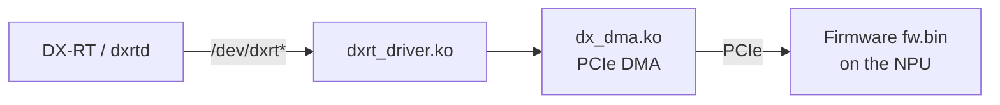

# NPU driver and firmware

This page covers the Linux NPU driver and the device firmware: which versions you need, how to build, update and check them, the module parameters, and the Yocto layer.

## Before you start

* For a first install, follow [Install](../get-started/install.md). It also covers the Windows driver.
* The driver source is in [dx_rt_npu_linux_driver](https://github.com/DEEPX-AI/dx_rt_npu_linux_driver). The firmware files are in [dx_fw](https://github.com/DEEPX-AI/dx_fw).

## Versions

DX-RT checks the driver and firmware versions when it starts. DX-RT 3.5.0 needs:

| Component | Linux | Windows |
|---|---|---|
| NPU driver (RT) | 2.7.0 | 1.8.0 |
| PCIe driver | 2.7.0 | 2.0.1 |
| Firmware | 2.7.6 | 2.7.6 |

Run `dxcli -v` to print the minimum versions of your DX-RT build, and `dxcli -i` to see what is installed. See [Compatibility](../get-started/compatibility.md) for the full matrix.

## How the pieces fit



The Linux driver has two kernel modules:

* `dx_dma`: the PCIe and DMA layer. It loads first.
* `dxrt_driver`: the runtime driver. It creates `/dev/dxrt*` and handles requests, reset and recovery.

`dx_dma.conf` holds `softdep dx_dma post: dxrt_driver`, so loading `dx_dma` also loads `dxrt_driver`.

## Check the device

List DEEPX PCIe devices (vendor ID `1ff4`):

```bash
lspci -d 1ff4:
sudo update-pciids     # to show names instead of IDs
```

| Name | Device ID | Product |
|---|---|---|
| `DX_M1` | `0x0000` | DX-M1 M.2. Also used by firmware 2.7.2 and later for all products |
| `M1 [Series]` | `0x0100` | DX-M1 |
| `M1M [Series]` | `0x0110` | DX-M1M |
| `M1 [H1]` | `0x0101` | DX-H1 Quattro |

Then check the modules and device files:

```bash
lsmod | grep dx
ls /dev/dxrt*
dxcli -s
```

## Build and install the driver

### Prerequisites

```bash
sudo apt-get install -y git build-essential linux-headers-$(uname -r) pciutils
sudo apt-get install -y dkms dpkg-dev debhelper rsync     # only for DKMS
```

### With build.sh

```bash
cd dx_rt_npu_linux_driver/modules
./build.sh                 # build for this kernel
sudo ./build.sh -c install # install
```

| Option | Default | Meaning |
|---|---|---|
| `-d, --device` | `m1` | Device |
| `-m, --module` | `deepx` | PCIe module |
| `-k, --kernel` | `/lib/modules/$(uname -r)/build` | Kernel build directory |
| `-a, --arch` | | Target architecture |
| `-t, --compiler` | | Cross compiler prefix |
| `-i, --install` | | Install path |
| `-c, --command` | | `clean`, `install`, `uninstall`, `debian-package`, `install-package` or `uninstall-package` |
| `-p, --pkg-version` | | Package version for the package commands |
| `-j, --jops` | | Parallel make jobs |
| `-f, --debug` | | Debug build: `debugfs`, `log` or `all` |
| `-v, --verbose` | | Verbose build |
| `--reload` | | Reload the modules after the build |
| `-h, --help` | | Show help |

A manual install puts the modules in `/lib/modules/<kernel>/extra/`. Load them with:

```bash
sudo depmod -A
sudo modprobe dx_dma
sudo modprobe dxrt_driver
```

### With make

```bash
make DEVICE=m1 PCIE=deepx
sudo make DEVICE=m1 PCIE=deepx install
make DEVICE=m1 PCIE=deepx clean
```

To cross compile, add `ARCH=arm64 CROSS_COMPILE=<toolchain>/aarch64-linux-gnu- KERNEL_DIR=<kernel source>`.

### With DKMS

DKMS rebuilds the driver when the kernel changes.

```bash
cd dx_rt_npu_linux_driver/modules
./build.sh -c debian-package                 # makes ../release/<VERSION>/dxrt-driver-dkms_<VERSION>-2_all.deb
sudo ./build.sh -c install-package           # or: sudo ./build.sh -c install-package -p <VERSION>
```

The package loads `virt_dma`, `dx_dma` and `dxrt_driver`. To remove it:

```bash
sudo ./build.sh -c uninstall-package
sudo dpkg --purge dxrt-driver-dkms
```

!!! warning "Do not mix DKMS and a manual install"
    Remove one before you install the other. To remove the DKMS package, run `sudo dpkg -r dxrt-driver-dkms`.

### Device permissions

`modules/install-udev_rule.sh` installs `/etc/udev/rules.d/51-deepx-udev.rules`, which gives `/dev/dxrt*` mode `0666` so you can use the NPU without `sudo`.

## Check the driver

```bash
cd dx_rt_npu_linux_driver
sudo ./sanity_check.sh
```

The sanity check tests the PCIe link, `/dev/dxrt*`, the loaded modules, the install state and PCIe ioctl calls. It saves results in `sanity/result/`. Its `pcie_test` step exits with:

| Code | Meaning |
|---|---|
| 0 | Pass |
| 1 | Opening the device failed |
| 2 | `IDENTIFY_DEVICE` failed |
| 3 | `WRITE_MEM` failed |
| 4 | `READ_MEM` failed |
| 5 | Read data did not match |

The DX-RT repository also has `SanityCheck.sh`. Run it with `all`, `dx_rt`, `dx_driver` or `help`. It prints the runtime, driver, PCIe driver, firmware and ONNX Runtime versions.

## Module parameters

Set parameters when you load a module, for example `sudo modprobe dxrt_driver ping_timeout_ms=1000`, or in a file in `/etc/modprobe.d/`.

`dxrt_driver`:

| Parameter | Type | Default | Meaning |
|---|---|---|---|
| `perm_fail_window_ms` | uint | 60000 | Sliding window in ms for counting recovery attempts |
| `perm_fail_max_retries` | uint | 5 | Recoveries within the window before the device enters permanent failure |
| `auto_reset_on_fw_timeout` | bool | 0 | Reset the device automatically when a firmware command times out |
| `dlmsg_ready_timeout_ms` | uint | 5000 | Wait in ms for the firmware mailbox to be ready after link up |
| `ping_timeout_ms` | uint | 500 | Timeout in ms of the ping and pong liveness probe |

`dx_dma`:

| Parameter | Type | Default | Meaning |
|---|---|---|---|
| `allow_sbr` | int | -1 | PCIe secondary bus reset policy: -1 automatic (by host topology), 0 function level reset only, 1 allow when the host supports it |
| `timeout` | uint | 3000 | Transfer timeout in ms |
| `dx_reg_max_pinned_mb` | ulong | 1024 | System wide cap in MiB on registered (long term pinned) memory |
| `shadow_wq` | int | 1 | Diagnostic: prebuild a shadow work queue for multi chunk scatter lists (1 on, 0 off) |
| `shadow_wq_min_sg` | uint | 16384 | Fewest scatter list entries for the shadow prebuild. 0 means always when `shadow_wq=1` |

## Firmware files

`dx_fw` holds one `fw.bin` per product and version:

| Path | Product |
|---|---|
| `m1/<version>/mdot2/fw.bin` | DX-M1 M.2 |
| `m1/<version>/h1/fw.bin` | DX-H1 Quattro |
| `m1m/<version>/mdot2/fw.bin` | DX-M1M M.2 |
| `uart_boot/{m1,m1m}/2.7.6/fw_uart_boot.bin` | UART boot images |

`latest` links to the newest version, 2.7.6. Older versions in the repository are 2.5.6 and 2.7.0 to 2.7.4.

## Update the firmware

1. Check the version in the file:

    ```bash
    dxcli -g m1/latest/mdot2/fw.bin
    ```

1. Stop the DX-RT service:

    ```bash
    sudo systemctl stop dxrt.service
    ```

1. Update the firmware. Use the file for your product. Add `-d <id>` to update one device only.

    ```bash
    dxcli -u m1/latest/mdot2/fw.bin
    ```

1. Start the service again:

    ```bash
    sudo systemctl start dxrt.service
    ```

1. Check the new version with `dxcli -i`.

`dxcli` prints `Don't turn off the power until the firmware download is done.` during the update.

!!! warning "Do not cut power during an update"
    Losing power while the firmware downloads can leave the device unusable.

| Message | Meaning |
|---|---|
| `The firmware must be version 2.0.0 or higher to update.` | The device firmware is too old for an online update |
| `A higher or equal version of the firmware has been downloaded.` | The device already has this version or a newer one. Use `dxcli -u <file> force` to install it anyway |

If the update fails, disable the service as well, update, and turn the service back on:

```bash
sudo systemctl disable dxrt.service
sudo systemctl stop dxrt.service
dxcli -u fw.bin
sudo systemctl enable dxrt.service
sudo systemctl start dxrt.service
```

`dxcli -u` resets the device after the update. Add `unreset` to skip the reset.

## The dxrtd service

On Linux, systemd runs `dxrtd` as `dxrt.service` (`ExecStart=/usr/local/bin/dxrtd`).

```bash
sudo systemctl status dxrt.service
sudo systemctl restart dxrt.service
sudo systemctl enable dxrt.service     # start at boot
journalctl -u dxrt.service             # logs
```

## Yocto layer meta-deepx-m1

[meta-deepx-m1](https://github.com/DEEPX-AI/meta-deepx-m1) adds the NPU driver, DX-RT and DX-Stream to a Yocto image. It targets the `scarthgap` release, has layer priority 6, and depends on the core layer, `meta-openembedded` and your board support layer. The build host needs about 16 GB of RAM and 100 GB of disk.

| Recipe | Versions |
|---|---|
| `dx-driver` | 1.8.0, 2.1.0, 2.4.1, 2.6.0, 2.7.0 |
| `dx-rt` | 3.1.0, 3.2.0, 3.2.0-1, 3.3.2, 3.4.1, 3.5.0 |
| `dx-stream` | 2.1.0 to 3.2.0 |
| `dx-stream-sample` | |
| `dx-yolo26`, `dx-yolo26-sample` | 0.2.0 |
| `libonnxruntime` | 1.20.1 |
| `libyuv` | |

Add the layer and the packages:

```bash
bitbake-layers add-layer ../sources/meta-deepx-m1
```

In `conf/local.conf`:

```text
IMAGE_INSTALL:append = " dx-driver dx-rt dx-stream dx-stream-sample"
IMAGE_INSTALL:append = " libonnxruntime libyuv"
IMAGE_INSTALL:append = " dx-yolo26 dx-yolo26-sample"
CORE_IMAGE_EXTRA_INSTALL += "ncurses-terminfo-base"
```

Build and check on the target:

```bash
bitbake core-image-weston
```

```bash
lsmod | grep dx
ls -l /usr/lib/libdxrt.so*
dxrt-cli -s
```

The Yocto `dx-rt` package installs the tools under their old names: `dxrt-cli`, `run_model` and `parse_model`, plus `dxrtd`, `dxtop` and `dxbenchmark`.

The `dx-yolo26-sample` package adds YOLO26 demo apps and a launcher, `/etc/dx-yolo26-sample/run.sh`, which takes a demo number from 0 to 4. Set `DXYOLO26_VARIANTS:pn-dx-yolo26 = "both"` to also build the synchronous variants. For DX-APP and the demos, see [DX-APP](../tools/app/index.md).

## Next steps

* [Troubleshooting](troubleshooting.md)
* [Command line tools](cli.md#dxcli)
* [Compatibility](../get-started/compatibility.md)
