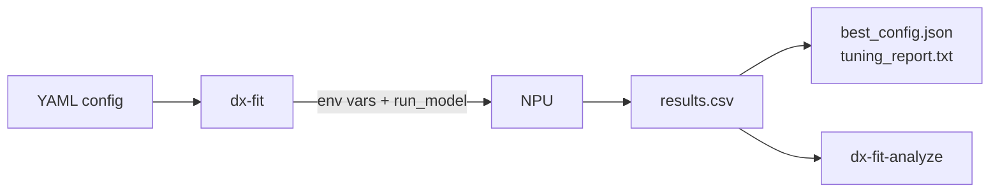

# DX-Fit

DX-Fit runs your model many times with different DX-RT runtime settings and tells you which settings give the highest FPS.

## Before you start

* Install DX-RT 3.0.0 or later, with `run_model` (`dxrun`) on your `PATH`. See [Install](../get-started/install.md).
* Python 3.6 or later.
* Clone [dx_rt](https://github.com/DEEPX-AI/dx_rt). DX-Fit is in `tool/dx-fit`.

## How it works

DX-Fit reads a YAML file with a search space of environment variables. For each combination it picks, it sets the variables, runs `run_model` on your model, and records FPS, latency, NPU time, temperature and voltage. At the end it reports the best combination.



## Install

```bash
cd dx_rt/tool/dx-fit
./install.sh
```

Or install the Python packages yourself:

```bash
pip install pandas pyyaml matplotlib seaborn scikit-optimize
```

`scikit-optimize` is needed only for the Bayesian strategy.

## Run a search

1. Copy an example config and set `model_path`.
1. Run DX-Fit from `tool/dx-fit`.
1. Analyze the results.

```bash
cd dx_rt/tool/dx-fit
cp examples/03_bayesian_quick.yaml my.yaml      # then edit model_path
python3 dx-fit my.yaml
python3 dx-fit-analyze results_<YYYYMMDD_HHMMSS>/results.csv -o analysis
```

Each run writes a folder `results_<YYYYMMDD_HHMMSS>/` with:

| File | Content |
|---|---|
| `results.csv` | One row per test: `test_id`, `success`, `fps`, `latency`, `npu_processing_time`, `run_time`, `cooling_time`, temperatures and voltages before and after, and the parameter values |
| `best_config.json` | The best result: `fps`, `latency`, `npu_time`, `parameters`, `thermal_data` and `timestamp` |
| `tuning_report.txt` | A text summary |

`dx-fit-analyze <csv> [-o dir]` prints statistics and saves `analysis_plots.png`.

## Configuration

```yaml
model_path: /path/to/your/model.dxnn

target_duration: 3.0      # seconds per test; DX-Fit picks the loop count
# loop_count: 100         # or a fixed loop count
warmup_runs: 5
timeout: 60               # seconds per test
use_ort: true

strategy: bayesian
max_random_samples: 30

parameters:
  DXRT_TASK_MAX_LOAD: [3, 6, 9, 12]
  DXRT_DYNAMIC_CPU_THREAD: [0, 1]
  CUSTOM_INTRA_OP_THREADS_COUNT: [1, 2]
  CUSTOM_INTER_OP_THREADS_COUNT: [1, 2]
  NFH_INPUT_WORKER_THREADS: [1, 2]
  NFH_OUTPUT_WORKER_THREADS: [1, 2, 4]

thermal_management:
  enabled: true
  target_temperature: 65.0
  max_temperature: 80.0
  check_interval: 5
  max_cooling_time: 300
```

| Key | Default | Meaning |
|---|---|---|
| `model_path` | | Model to tune. Required |
| `loop_count` | 100 | Inferences per test |
| `target_duration` | | Seconds per test. Takes priority over `loop_count`. DX-Fit uses `loop-selector` to turn it into a loop count |
| `warmup_runs` | 5 | Warmup runs per test |
| `timeout` | 300 | Seconds before a test is stopped |
| `use_ort` | `true` | Run CPU tasks with ONNX Runtime |
| `strategy` | `grid` | `grid`, `random` or `bayesian` |
| `max_random_samples` | 100 | Tests for `random`. For `bayesian`, the number of calls. The first `min(10, N/2)` are random |
| `use_python` | `false` | Use the Python version of `run_model` |
| `parameters` | | Map from environment variable to a list of values |
| `thermal_management` | | See [Thermal management](#thermal-management) |

### Strategies

| Strategy | How it searches | Use it when |
|---|---|---|
| `grid` | Tries every combination | The space is small, or you need the exact best |
| `random` | Tries `max_random_samples` random combinations | The space is large and you want a quick, broad look |
| `bayesian` | Models the results so far and picks the most promising next combination | The space is large and each test is slow |

### Parameters

| Variable | What it sets | Typical values |
|---|---|---|
| `DXRT_TASK_MAX_LOAD` | Requests in flight (the buffer count) | 2 to 16 |
| `DXRT_DYNAMIC_CPU_THREAD` | Dynamic CPU threads | 0, 1 |
| `CUSTOM_INTRA_OP_THREADS_COUNT` | ONNX Runtime intra op threads | 1 to 8 |
| `CUSTOM_INTER_OP_THREADS_COUNT` | ONNX Runtime inter op threads | 1 to 4 |
| `NFH_INPUT_WORKER_THREADS` | Input format conversion workers | 1 to 4 |
| `NFH_OUTPUT_WORKER_THREADS` | Output format conversion workers | 1 to 8 |

### Thermal management

The NPU slows down when it is hot, which skews the comparison. With thermal management on, DX-Fit waits between tests until the device cools down.

| Key | Default | Meaning |
|---|---|---|
| `enabled` | `false` | Turn it on |
| `target_temperature` | 65 | Cool down to this temperature in °C before the next test |
| `max_temperature` | 80 | Safety limit in °C |
| `fixed_cooldown_seconds` | 0 | A fixed wait between tests, in seconds |
| `check_interval` | 5 | Seconds between temperature checks |
| `max_cooling_time` | 300 | Longest wait in seconds |

### Example configs

`tool/dx-fit/examples` has ready configs:

| File | Strategy | Notes |
|---|---|---|
| `01_template.yaml` | | Every key, with comments |
| `02_quick_random.yaml` | random | A fast first look |
| `03_bayesian_quick.yaml` | bayesian | 10 calls |
| `04_bayesian_standard.yaml` | bayesian | A fuller search |
| `05_grid_small.yaml` | grid | A small grid |
| `06_thermal_bayesian.yaml` | bayesian | With temperature based cooling |
| `07_thermal_fixed_cooldown.yaml` | | With a fixed wait between tests |
| `08_grid_full.yaml` | grid | The full grid. Slow |
| `quick.yaml`, `standard.yaml`, `advanced.yaml` | | Presets |

!!! warning "Fixed cool down key"
    `06_thermal_bayesian.yaml` and `07_thermal_fixed_cooldown.yaml` use `cooldown_duration`, which DX-Fit does not read. Use `fixed_cooldown_seconds` for a fixed wait.

## Apply the result

`best_config.json` lists the winning variables under `parameters`. Export them before you run your application, then check the result:

```bash
jq -r '.parameters | to_entries[] | "export \(.key)=\(.value)"' \
  results_<YYYYMMDD_HHMMSS>/best_config.json > apply_config.sh
source apply_config.sh
dxrun -m /path/to/model.dxnn -l 100 --use-ort -v
```

As an example, one 30 test search on YOLOv5S went from 69.59 FPS to 178.79 FPS (2.57 times) with `DXRT_TASK_MAX_LOAD=14`, `CUSTOM_INTRA_OP_THREADS_COUNT=1`, `CUSTOM_INTER_OP_THREADS_COUNT=1` and `NFH_OUTPUT_WORKER_THREADS=8`. Your best values depend on your model and host.

## loop-selector

`tool/loop-selector/loop-selector` finds a loop count that makes a run last a given time. DX-Fit calls it when you set `target_duration`. You can also use it alone.

```bash
loop-selector model.dxnn --target-duration 3.0 --format value
```

It measures FPS over a few samples and sets loops to FPS times the duration. If the coefficient of variation is above 5%, it measures again, up to 3 times.

| Option | Default | Meaning |
|---|---|---|
| `model` | | Model file |
| `--target-duration` | 3.0 | Seconds the run should last |
| `--format` | `text` | `text`, `value`, `json`, `yaml` or `env` |
| `--explain` | | Show how the count was found |
| `--update-yaml FILE` | | Write the loop count into a DX-Fit config |
| `--run-model` | | Run `run_model` with the result |
| `--samples` | 3 | Number of FPS samples |

## Next steps

* [Configuration](configuration.md)
* [Command line tools](cli.md#dxrun)
* [Troubleshooting](troubleshooting.md)
