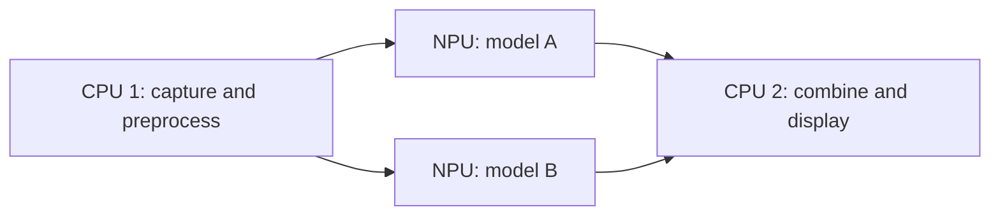
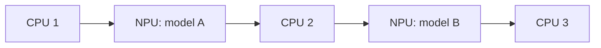

# Tutorials

These tutorials walk from a first synchronous program to a pipelined async application, and point you to the matching example in the DX-RT repository.

## Before you start

* Install DX-RT. See [Install](../get-started/install.md).
* Get a `.dxnn` model, for example from DX-ModelZoo.
* Clone [dx_rt](https://github.com/DEEPX-AI/dx_rt) to get the example sources in `examples/python` and `examples/cpp`.

## Run the examples

=== "Python"

    ```bash
    cd dx_rt
    python examples/python/run_sync_model.py -m /path/to/model.dxnn -l 100
    python examples/python/run_async_model.py -m /path/to/model.dxnn -l 1000 -v
    python examples/python/run_batch_model.py -m /path/to/model.dxnn -b 4 -l 100
    ```

=== "C++"

    ```bash
    cd dx_rt
    ./build.sh
    cd bin/examples      # or <install prefix>/bin/examples
    ./run_sync_model -m /path/to/model.dxnn -l 100
    ./run_async_model -m /path/to/model.dxnn -l 1000 -v
    ./run_batch_model -m /path/to/model.dxnn -b 4 -l 100
    ```

`build.sh` builds the C++ examples with DX-RT. You cannot build `examples/cpp` on its own with CMake, because it uses build helpers internal to DX-RT. To build your own program, see [Headers and linking](cpp-api.md#headers-and-linking).

Most examples take `-m, --model` (required), `-l, --loops` (default 1), `-v, --verbose` and `-h, --help`. `run_batch_model` also takes `-b, --batch`. In `run_async_model_callback.py`, `-b` means `--benchmark`.

## Example catalog

| Example | Python | C++ | Shows |
|---|---|---|---|
| `run_sync_model` | yes | yes | Synchronous inference in one thread |
| `run_async_model` | yes | yes | Async inference with a callback |
| `run_async_model_callback` | yes | | Callback variants and user arguments |
| `run_async_model_wait` | yes | yes | Async inference with `wait` instead of a callback |
| `run_async_model_thread` | yes | yes | One engine shared by several threads |
| `run_batch_model` | yes | yes | Batch inference |
| `run_sync_model_bound` | yes | yes | Binding to NPU cores |
| `run_async_model_bound` | | yes | Binding with async inference |
| `run_sync_model_bufcount`, `run_async_model_bufcount` | yes | yes | Buffer count tuning |
| `run_async_model_conf` | yes | yes | `Configuration` and device status |
| `check_versions` | | yes | Runtime, driver, firmware and ONNX Runtime versions |
| `device_monitoring` | yes | yes | `DeviceStatus`, optionally during inference. Python takes `--no-inference` |
| `run_sync_model_memory` | yes | yes | Loading a model from memory |
| `run_sync_model_output`, `run_async_model_output` | | yes | Your own output buffers |
| `run_async_model_profiler` | yes | yes | The profiler |
| `run_benchmark_model` | yes | | Benchmark with warmup |
| `multi_input_model_inference` | yes | yes | Multi input models |
| `display_async_wait` | | yes | Two models in parallel on one input |
| `display_async_pipe` | | yes | Two models in sequence |
| `display_async_thread` | | yes | One model, several threads |
| `display_async_thread_local_engines` | | yes | One engine per thread |
| `display_async_precreated_engines` | | yes | Engines made in the main thread, used by workers |

## Tutorial 1: a first inference

This program loads a model, prints its tensors, runs one inference and prints the outputs.

=== "Python"

    ```python
    import sys
    import numpy as np
    from dx_engine import InferenceEngine

    def main(model_path):
        with InferenceEngine(model_path) as ie:
            for t in ie.get_input_tensors_info():
                print("input ", t["name"], t["shape"], t["dtype"])
            for t in ie.get_output_tensors_info():
                print("output", t["name"], t["shape"], t["dtype"])

            buf = np.empty(ie.get_input_size(), dtype=np.uint8)
            buf.fill(0)
            outputs = ie.run([buf])

            for out in outputs:
                print(out.shape, out.dtype)

    if __name__ == "__main__":
        main(sys.argv[1])
    ```

=== "C++"

    ```cpp
    #include <dxrt/dxrt_cxx_api.h>
    #include <iostream>
    #include <vector>

    int main(int argc, char* argv[])
    {
        if (argc < 2) return 1;
        try {
            dxrt::InferenceEngine ie(argv[1]);
            auto names = ie.GetInputTensorNames();
            auto sizes = ie.GetInputTensorSizes();
            for (size_t i = 0; i < names.size(); ++i)
                std::cout << "input  " << names[i] << " " << sizes[i] << " bytes\n";

            std::vector<uint8_t> input(ie.GetInputSize(), 0);
            auto outputs = ie.Run(input.data());

            for (auto& t : outputs) {
                std::cout << "output " << t->name() << " shape [";
                for (auto d : t->shape()) std::cout << d << " ";
                std::cout << "] " << dxrt::DataTypeToString(t->type()) << "\n";
            }
        } catch (const dxrt::Exception& e) {
            std::cerr << e.what() << " error-code=" << e.code() << "\n";
            return -1;
        } catch (const std::exception& e) {
            std::cerr << e.what() << "\n";
            return -1;
        }
        return 0;
    }
    ```

In real code, fill the input with a preprocessed image in the model's input shape and data type, for example `uint8` NHWC.

## Tutorial 2: from sync to async

`Run` uses one request at a time. To keep all NPU cores busy, switch to `RunAsync`:

1. Use several input and output buffers, so a new request does not overwrite one still in flight.
1. Submit requests with `RunAsync` and collect results with a callback or a `Wait` thread.
1. Pass data between threads with a thread safe queue.


This program keeps a pool of input buffers, runs many frames async and post processes them in another thread.

=== "Python"

    ```python
    import queue
    import threading
    import numpy as np
    from dx_engine import InferenceEngine, InferenceOption

    LOOPS = 1000
    POOL = 8

    option = InferenceOption()
    option.buffer_count = POOL

    with InferenceEngine("model.dxnn", option) as ie:
        pool = []
        for _ in range(POOL):
            buf = np.empty(ie.get_input_size(), dtype=np.uint8)
            buf.fill(0)
            pool.append(buf)

        free_slots = queue.Queue()
        for i in range(POOL):
            free_slots.put(i)
        results = queue.Queue()

        def on_done(outputs, slot):
            results.put([o.copy() for o in outputs])
            free_slots.put(slot)          # the input buffer can be reused now
            return 0

        def post_process():
            for _ in range(LOOPS):
                outputs = results.get()
                # decode boxes, draw, save ...

        ie.register_callback(on_done)
        worker = threading.Thread(target=post_process)
        worker.start()

        for frame in range(LOOPS):
            slot = free_slots.get()
            # write the next preprocessed frame into pool[slot] here
            ie.run_async([pool[slot]], user_arg=slot)

        worker.join()
        ie.register_callback(None)
    ```

=== "C++"

    ```cpp
    #include <dxrt/dxrt_cxx_api.h>
    #include <condition_variable>
    #include <mutex>
    #include <queue>
    #include <thread>
    #include <vector>

    template <typename T>
    class SafeQueue {
    public:
        void push(T v) { { std::lock_guard<std::mutex> l(m_); q_.push(std::move(v)); } cv_.notify_one(); }
        T pop() {
            std::unique_lock<std::mutex> l(m_);
            cv_.wait(l, [&] { return !q_.empty(); });
            T v = std::move(q_.front()); q_.pop(); return v;
        }
    private:
        std::mutex m_; std::condition_variable cv_; std::queue<T> q_;
    };

    int main()
    {
        const int LOOPS = 1000, POOL = 8;
        dxrt::InferenceOption option;
        option.bufferCount = POOL;
        dxrt::InferenceEngine ie("model.dxnn", option);

        std::vector<std::vector<uint8_t>> pool(POOL, std::vector<uint8_t>(ie.GetInputSize(), 0));
        SafeQueue<int> freeSlots;
        for (int i = 0; i < POOL; ++i) freeSlots.push(i);
        SafeQueue<dxrt::TensorPtrs> results;

        ie.RegisterCallback([&](dxrt::TensorPtrs& outputs, void* userArg) {
            results.push(outputs);
            freeSlots.push(static_cast<int>(reinterpret_cast<intptr_t>(userArg)));
            return 0;
        });

        std::thread post([&] {
            for (int i = 0; i < LOOPS; ++i) {
                auto outputs = results.pop();
                // decode boxes, draw, save ...
            }
        });

        for (int frame = 0; frame < LOOPS; ++frame) {
            int slot = freeSlots.pop();
            // write the next preprocessed frame into pool[slot] here
            ie.RunAsync(pool[slot].data(), reinterpret_cast<void*>(static_cast<intptr_t>(slot)));
        }
        post.join();
        return 0;
    }
    ```

Notes:

* Keep the callback short. It runs on a runtime thread.
* Copy or hand off the outputs in the callback. Do not do heavy work there.
* The buffer count of the engine caps the requests in flight. Match your pool size to it.

## Tutorial 3: multi model pipelines

The C++ `display_async_*` examples show common camera, inference and display patterns with two models.

**Parallel** (`display_async_wait`): one frame goes to two models at once, and a display thread joins the results.



**Sequential** (`display_async_pipe`): the output of model A, after CPU work, feeds model B.



Choose how threads and engines relate:

| Pattern | Example | When to use |
|---|---|---|
| One engine, many threads | `display_async_thread`, `run_async_model_thread` | Several streams with the same model |
| One engine per thread | `display_async_thread_local_engines` | Each thread owns its model and options |
| Engines made up front | `display_async_precreated_engines` | Avoid load time in worker threads |

To run several models side by side on fixed cores, give each engine its own `boundOption`. See [Bound option](configuration.md#bound-option).

## Tutorial 4: monitoring and profiling

Add device monitoring and profiling to any program. The `device_monitoring` and `run_async_model_profiler` examples do this.

=== "Python"

    ```python
    from dx_engine import Configuration, DeviceStatus, Profiler

    config = Configuration()
    config.set_enable(Configuration.ITEM.PROFILER, True)
    config.set_attribute(Configuration.ITEM.PROFILER,
                         Configuration.ATTRIBUTE.PROFILER_SAVE_DATA, "ON")

    # ... create the engine and run inference ...

    s = DeviceStatus.get_current_status(0)
    print("temp", s.get_temperature(0), "util", s.get_core_utilization(0))
    Profiler.get_instance().show()
    ```

=== "C++"

    ```cpp
    auto& config = dxrt::Configuration::GetInstance();
    config.SetEnable(dxrt::Configuration::ITEM::PROFILER, true);
    config.SetAttribute(dxrt::Configuration::ITEM::PROFILER,
                        dxrt::Configuration::ATTRIBUTE::PROFILER_SAVE_DATA, "ON");

    // ... create the engine and run inference ...

    auto s = dxrt::DeviceStatus::GetCurrentStatus(0);
    std::cout << s.GetStatusString() << "\n";
    dxrt::Profiler::GetInstance().Show();
    ```

At exit, `profiler.json` is written to the working directory. Plot it as shown in [Plot the timeline](configuration.md#plot-the-timeline).

## Next steps

* [Run inference](run-inference.md)
* [Configuration](configuration.md)
* [DX-Fit](dx-fit.md)
* [Tutorials for the whole SDK](../tutorials/index.md)
