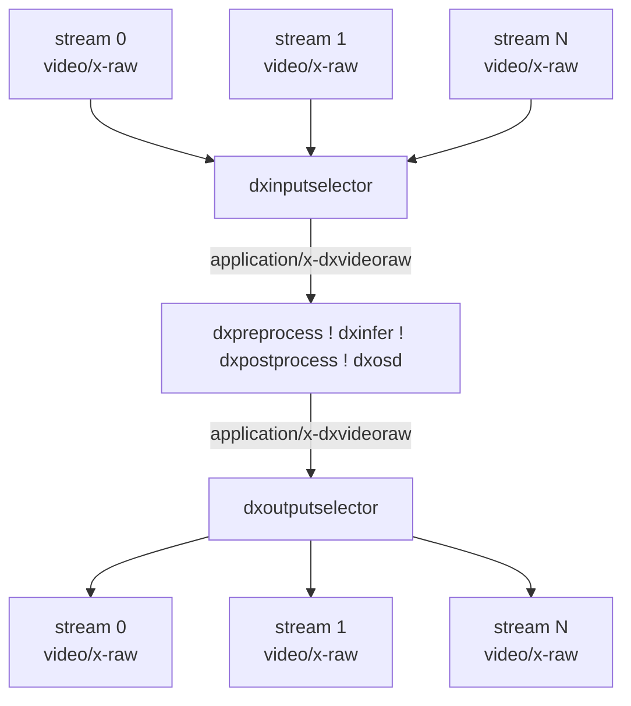

# Multi stream domain

This page explains how several video streams share one inference chain between `dxinputselector` and `dxoutputselector`. You only need it when you use those two elements; single stream pipelines negotiate normal `video/x-raw`.

## The domain boundary



Inside the domain every element negotiates these caps:

```text
application/x-dxvideoraw,
  width=(int)[1, MAX],
  height=(int)[1, MAX],
  framerate=(fraction)[0/1, MAX]
```

The caps carry ranges and no `format`. The real size, format and stream of each buffer are in its `DXFrameMeta`, so one chain can process streams with different resolutions and color formats. Standard elements such as `videoconvert`, `videoscale` or `compositor` do not accept these caps, so a wrong placement fails at link time.

## Placement rules

| Element | Inside the domain | Outside | Why |
|---|:-:|:-:|---|
| `dxpreprocess`, `dxinfer`, `dxpostprocess`, `dxosd`, `dxrate`, `dxtracker` | Yes | Yes | Dual mode: the element reads size and stream from `DXFrameMeta`. |
| `dxmsgconv`, `dxmsgbroker` | Yes | Yes | They only read metadata. |
| `dxscale`, `dxconvert` | No | Yes | They need one stable caps for buffer pools and kernels. |
| `dxgather` | No | Yes | It merges branches of one source and has no notion of stream ID. |
| `dxinputselector`, `dxoutputselector` | Boundary | No | Domain entry and exit. |

Put `dxscale` and `dxconvert` per stream before `dxinputselector` or per output after `dxoutputselector`:

```text
src0 ! decodebin ! dxscale ! dxconvert ! in.sink_0
src1 ! decodebin ! dxscale ! dxconvert ! in.sink_1
dxinputselector name=in ! ... ! dxoutputselector name=out
```

## Per buffer identity

| `DXFrameMeta` field | Meaning |
|---|---|
| `_stream_id` | Stream index, set by `dxinputselector` from the sink pad number. |
| `_width`, `_height`, `_format` | Size and format of this buffer. |

If a buffer reaches `dxinputselector` without `DXFrameMeta`, the selector creates one. Up to 64 streams are supported (`_stream_id` 0 to 63); buffers with another ID are dropped with a warning.

How dual mode elements keep state per stream:

| Element | Per stream behavior |
|---|---|
| `dxtracker` | One OC_SORT instance per stream. Track IDs are independent, so the same ID can appear in two streams. |
| `dxosd` | Stores the video info of each stream from the wrapped CAPS events. |
| `dxrate` | Own first PTS, drop and duplicate counters per stream. |
| `dxinfer` | One shared NPU; latency is reported once for the whole domain. |

## Events

Three kinds of events flow through the domain. The boundary elements wrap and unwrap them; you never build them yourself.

| Kind | Events | Handling |
|---|---|---|
| Domain events | One `STREAM_START`, `CAPS` (`application/x-dxvideoraw`), `SEGMENT`, and a final `EOS` | Sent once by `dxinputselector`. Dropped by `dxoutputselector`. |
| Pipeline events | `FLUSH_START`, `FLUSH_STOP`, unwrapped `TAG` and `GAP` | Passed through; `dxoutputselector` sends them to every output. |
| Per stream events | Each input's own `STREAM_START`, `CAPS` (`video/x-raw`), `SEGMENT`, `TAG`, `EOS`, `GAP` | Wrapped as `CUSTOM_DOWNSTREAM` events of type `application/x-dx-wrapped-event` with the stream ID, unwrapped by `dxoutputselector` to the matching output. |

Upstream `QoS` and `RECONFIGURE` events from an output are wrapped (`application/x-dx-wrapped-event-upstream`) and routed by `dxinputselector` to the matching input, so a slow output only slows its own source.

`EOS` on one input does not end the chain. `dxinputselector` sends the global `EOS` only after every input reached `EOS`, and `dxoutputselector` does not forward it (see [DxOutputSelector](dxoutputselector.md)).

## Queries

`LATENCY`, `ALLOCATION`, `POSITION` and `DURATION` work across the domain. Each element inside adds its own processing time to `LATENCY`; the domain reports one latency for all streams. During `ALLOCATION`, dual mode elements ask for `DXFrameMeta` as buffer meta.

## Next steps

* [DxInputSelector](dxinputselector.md)
* [DxOutputSelector](dxoutputselector.md)
* [Multi stream pipelines](../pipelines.md#multi-stream)
* [Domain errors and fixes](../debugging.md#could-not-link-after-dxinputselector)
