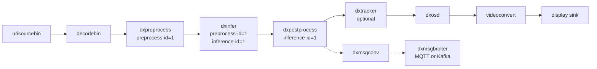

# DX-Stream overview

DX-Stream lets you build real time video AI pipelines on DEEPX NPUs with GStreamer. It is a GStreamer plugin (`dxstream`) with elements for preprocessing, NPU inference, postprocessing, tracking, drawing and messaging. You build an application by chaining these elements with standard GStreamer elements, either on the command line with `gst-launch-1.0` or in your own Python or C++ program.

DX-Stream 3.2.0 is part of DEEPX SDK 2.5.0 and needs DX-RT 3.5.0 and the NPU driver on the same machine.

## How the elements chain

Every inference step uses the same three elements: `dxpreprocess` prepares an input tensor, `dxinfer` runs the `.dxnn` model on the NPU, and `dxpostprocess` turns the output tensors into objects. The elements pass results along in metadata attached to each video buffer (`DXFrameMeta` for the frame, `DXObjectMeta` for each object).

The IDs connect the stages: `dxinfer` reads the tensor whose `preprocess-id` matches, and `dxpostprocess` reads the output whose `inference-id` matches. With different IDs you can run several models in one pipeline (see [Pipelines](pipelines.md)).

| Stage | Elements |
|---|---|
| Inference | [DxPreprocess](elements/dxpreprocess.md), [DxInfer](elements/dxinfer.md), [DxPostprocess](elements/dxpostprocess.md) |
| Analytics and display | [DxTracker](elements/dxtracker.md), [DxOsd](elements/dxosd.md) |
| Stream control | [DxGather](elements/dxgather.md), [DxInputSelector](elements/dxinputselector.md), [DxOutputSelector](elements/dxoutputselector.md), [DxRate](elements/dxrate.md) |
| Messaging | [DxMsgConv](elements/dxmsgconv.md), [DxMsgBroker](elements/dxmsgbroker.md) |
| Video transform | [DxScale](elements/dxscale.md), [DxConvert](elements/dxconvert.md) |
| DX-H1 V-NPU codec | [DxVnpuDec](elements/dxvnpudec.md), [DxVnpuEnc](elements/dxvnpuenc.md) |

`dxpreprocess`, `dxpostprocess` and `dxmsgconv` load your own shared library when the built in behavior does not fit your model. Models must be compiled to `.dxnn` with DX-COM first (see [DX-COM](../compiler/index.md)).

## Where to go

* [Build and install](build.md): build DX-Stream from source on Linux, set up the environment, run the demos.
* [Build on Orange Pi 5 Plus](build-orange-pi.md) and [Build on Windows](build-windows.md).
* [Elements](elements/index.md): one reference page per element with pads and properties.
* [Write an application](write-an-application.md): run pipelines from Python or C++ and write custom pre and postprocess libraries.
* [Python bindings (pydxs)](python-bindings.md): read and write DX-Stream metadata from Python.
* [Pipelines](pipelines.md): single stream, multi stream, secondary inference and message broker examples.
* [User metadata](user-metadata.md): attach your own data to frames and objects.
* [Performance with GstShark](performance.md): measure CPU use, latency and frame rate per element.
* [Debugging and troubleshooting](debugging.md): debug logs, common errors and fixes.
* [Third party model licenses](licenses.md): what you may do with the sample models.

## Next steps

* [Install the DEEPX SDK](../get-started/install.md)
* [Build and install DX-Stream](build.md)
