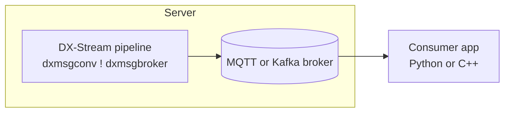

# Pipelines

This page gives you working pipelines for the common DX-Stream patterns. Each one matches a demo script under `dx_stream/pipelines/`, which you can run directly.

## Before you start

* DX-Stream built ([Build and install](build.md)) and `source ~/.bashrc` done.
* Sample models and videos downloaded with `./setup.sh`.
* A terminal in the repository root. The configs in `dx_stream/configs/` use paths relative to it.
* A display. On a machine without one, replace `videoconvert ! fpsdisplaysink sync=false` with `fakesink sync=false`.

## Demo scripts

| Script | Pattern |
|---|---|
| `single_network/object_detection/run_yolo26n.sh` | Detection with YOLO26n |
| `single_network/object_detection/run_YoloV5S_PPU.sh` | Detection with YOLOv5s on the PPU |
| `single_network/face_detection/run_YOLOv5s_Face.sh`, `run_SCRFD500M.sh` | Face detection |
| `single_network/pose_estimation/run_yolo26n-pose.sh` | Pose estimation |
| `single_network/instance_segmentation/run_yolo26n-seg.sh` | Instance segmentation |
| `single_network/depth_estimation/run_yolo26n-depth.sh` | Depth estimation |
| `tracking/run_multi_object_tracker.sh` | Detection and tracking |
| `multi_stream/run_multi_stream.sh` | One sub pipeline per stream |
| `multi_stream/run_multi_stream_selector.sh` | Shared chain with DxInputSelector and DxOutputSelector |
| `rtsp/run_RTSP.sh` | Multi channel RTSP input |
| `secondary_mode/run_secondary_mode.sh` | Detection, tracking and two secondary models |
| `broker/run_dxmsgbroker_mqtt.sh`, `run_dxmsgbroker_kafka.sh` | Messages to MQTT or Kafka |
| `dxvnpu/run_dxvnpudec.sh`, `run_dxvnpuenc.sh`, `run_dxvnpuinf.sh` | DX-H1 V-NPU decode, encode, inference |
| `raspberry_pi/run_rpi_camera_*.sh` | Raspberry Pi CSI camera |

```bash
dx_stream/pipelines/single_network/object_detection/run_yolo26n.sh
```

## Single stream

Read a file, detect objects with YOLO26n, draw them and show the result with the frame rate:

```bash
gst-launch-1.0 urisourcebin uri=file://$PWD/dx_stream/samples/videos/boat.mp4 ! decodebin ! queue max-size-buffers=1 ! \
  dxpreprocess preprocess-id=1 resize-width=640 resize-height=640 ! queue max-size-buffers=1 ! \
  dxinfer preprocess-id=1 inference-id=1 model-path=$PWD/dx_stream/samples/models/yolo26-n_640x640.dxnn ! queue max-size-buffers=1 ! \
  dxpostprocess inference-id=1 library-file-path=/usr/local/share/gstdxstream/lib/libpostprocess_yolo26od.so function-name=PostProcess ! queue max-size-buffers=1 ! \
  dxosd ! queue max-size-buffers=1 ! \
  videoconvert ! fpsdisplaysink sync=false
```

| Element | Role |
|---|---|
| `urisourcebin` | Reads the input. `uri` must be a URI such as `file:///path/to/video.mp4`. |
| `decodebin` | Decodes the video. |
| `dxpreprocess`, `dxinfer`, `dxpostprocess` | Inference, linked by `preprocess-id` and `inference-id`. |
| `dxosd` | Draws the results. |
| `queue max-size-buffers=1` | Runs each stage in its own thread so stages work on different frames in parallel, and prevents deadlocks. |
| `fpsdisplaysink sync=false` | Shows video and FPS. `sync=false` shows every frame as fast as possible. Use `sync=true` to play at the file's rate and let late frames drop. |

Use other models by changing the model, the size and the postprocess library (see [DxPostprocess](elements/dxpostprocess.md#shipped-postprocess-libraries)). The same chain with JSON configs, as in `run_YoloV5S_PPU.sh`:

```bash
gst-launch-1.0 urisourcebin uri=file://$PWD/dx_stream/samples/videos/boat.mp4 ! decodebin ! queue max-size-buffers=1 ! \
  dxpreprocess config-file-path=dx_stream/configs/YoloV5S_PPU/preprocess_config.json ! queue max-size-buffers=1 ! \
  dxinfer config-file-path=dx_stream/configs/YoloV5S_PPU/inference_config.json ! queue max-size-buffers=1 ! \
  dxpostprocess config-file-path=dx_stream/configs/YoloV5S_PPU/postprocess_config.json ! queue max-size-buffers=1 ! \
  dxosd ! queue max-size-buffers=1 ! \
  videoconvert ! fpsdisplaysink sync=false
```

Other display sinks: `autovideosink` picks one for your platform; `ximagesink` renders on the CPU under X11.

## Single stream with tracking

Add `dxtracker` after detection. `dxosd` then also shows the track ID of each box.

```bash
gst-launch-1.0 urisourcebin uri=file://$PWD/dx_stream/samples/videos/boat.mp4 ! decodebin ! queue max-size-buffers=1 ! \
  dxpreprocess config-file-path=dx_stream/configs/YoloV5S_PPU/preprocess_config.json ! queue max-size-buffers=1 ! \
  dxinfer config-file-path=dx_stream/configs/YoloV5S_PPU/inference_config.json ! queue max-size-buffers=1 ! \
  dxpostprocess config-file-path=dx_stream/configs/YoloV5S_PPU/postprocess_config.json ! queue max-size-buffers=1 ! \
  dxtracker config-file-path=dx_stream/configs/tracker_config.json ! queue max-size-buffers=1 ! \
  dxosd ! queue max-size-buffers=1 ! \
  videoconvert ! fpsdisplaysink sync=false
```

## Multi stream

There are two ways to run several streams.

| Approach | How | Trade off |
|---|---|---|
| Sub pipelines (`run_multi_stream.sh`) | One full `dxpreprocess ! dxinfer ! dxpostprocess` chain per stream, tiled with `compositor` | Each chain runs on its own; uses more memory per stream. |
| Selectors (`run_multi_stream_selector.sh`) | `dxinputselector` merges all streams into one chain, `dxoutputselector` splits them again | One chain for all streams; the speed gain of sub pipelines can be small. |

The selector version for two files, tiled side by side (each output is scaled with `dxscale` after `dxoutputselector`, because `dxscale` cannot run inside the [multi stream domain](elements/multi-stream-domain.md)):

```bash
V=$PWD/dx_stream/samples/videos
gst-launch-1.0 \
  urisourcebin uri=file://$V/boat.mp4 ! queue max-size-buffers=10 ! decodebin ! queue max-size-buffers=10 ! in.sink_0 \
  urisourcebin uri=file://$V/blackbox-city-road.mp4 ! queue max-size-buffers=10 ! decodebin ! queue max-size-buffers=10 ! in.sink_1 \
  dxinputselector name=in ! \
  dxpreprocess config-file-path=dx_stream/configs/YoloV5S_PPU/preprocess_config.json ! queue max-size-buffers=10 ! \
  dxinfer config-file-path=dx_stream/configs/YoloV5S_PPU/inference_config.json ! queue max-size-buffers=10 ! \
  dxpostprocess config-file-path=dx_stream/configs/YoloV5S_PPU/postprocess_config.json ! queue max-size-buffers=10 ! \
  dxosd ! dxoutputselector name=out \
  out.src_0 ! queue max-size-buffers=10 ! dxscale width=640 height=360 ! queue max-size-buffers=10 ! comp.sink_0 \
  out.src_1 ! queue max-size-buffers=10 ! dxscale width=640 height=360 ! queue max-size-buffers=10 ! comp.sink_1 \
  compositor name=comp sink_0::xpos=0 sink_0::ypos=0 sink_1::xpos=640 sink_1::ypos=0 ! \
  videoconvert ! fpsdisplaysink sync=false
```

The script `run_multi_stream_selector.sh` builds the same command for up to 16 files from `dx_stream/samples/videos/` on a 1280x720 grid. `run_RTSP.sh` does the same with RTSP cameras as input.

!!! note
    The global end of stream is not forwarded by `dxoutputselector`, so this command keeps running after the files end. Stop it with Ctrl+C.

## Secondary inference

Secondary models run on each detected object instead of the whole frame. This pipeline detects and tracks objects, then runs two secondary models in parallel `tee` branches, and `dxgather` merges the results:

1. EfficientNet-Lite0 classifies every object at least 50x50 pixels, every 5th frame.
1. SCRFD-500M finds faces only on class 0 objects (`target-class-id=0`) at least 50x50 pixels, every 5th frame.

```bash
S=$PWD/dx_stream
gst-launch-1.0 urisourcebin uri=file://$S/samples/videos/dance-group.mov ! decodebin ! queue max-size-buffers=1 ! \
  dxpreprocess config-file-path=$S/configs/YoloV5S_PPU/preprocess_config.json ! queue max-size-buffers=1 ! \
  dxinfer config-file-path=$S/configs/YoloV5S_PPU/inference_config.json ! queue max-size-buffers=1 ! \
  dxpostprocess config-file-path=$S/configs/YoloV5S_PPU/postprocess_config.json ! queue max-size-buffers=1 ! \
  dxtracker config-file-path=$S/configs/tracker_config.json ! queue max-size-buffers=1 ! \
  tee name=t \
  t. ! queue max-size-buffers=1 ! \
    dxpreprocess preprocess-id=2 resize-width=224 resize-height=224 secondary-mode=true interval=5 min-object-width=50 min-object-height=50 keep-ratio=false ! queue max-size-buffers=1 ! \
    dxinfer preprocess-id=2 inference-id=2 secondary-mode=true model-path=$S/samples/models/efficientnet-lite0_224x224.dxnn ! queue max-size-buffers=1 ! \
    dxpostprocess inference-id=2 secondary-mode=true library-file-path=/usr/local/share/gstdxstream/lib/libpostprocess_object_class.so function-name=PostProcess ! queue max-size-buffers=1 ! \
    gather.sink_0 \
  t. ! queue max-size-buffers=1 ! \
    dxpreprocess preprocess-id=3 resize-width=640 resize-height=640 keep-ratio=true pad-value=114 secondary-mode=true target-class-id=0 min-object-width=50 min-object-height=50 interval=5 ! queue max-size-buffers=1 ! \
    dxinfer preprocess-id=3 inference-id=3 secondary-mode=true model-path=$S/samples/models/scrfd-500m_640x640.dxnn ! queue max-size-buffers=1 ! \
    dxpostprocess inference-id=3 secondary-mode=true library-file-path=/usr/local/share/gstdxstream/lib/libpostprocess_scrfd500m.so function-name=PostProcess ! queue max-size-buffers=1 ! \
    gather.sink_1 \
  dxgather name=gather ! queue ! dxosd ! queue ! videoconvert ! fpsdisplaysink sync=false
```

* Give every model its own `preprocess-id` and `inference-id` (here 1, 2 and 3), and set `secondary-mode=true` on all three elements of a secondary chain.
* A secondary postprocess function must change the `DXObjectMeta` it gets, never remove or reallocate it.

## Message broker

`dxmsgconv` turns the results into JSON and `dxmsgbroker` publishes them. A consumer app on any machine receives them.



The consumer machine needs only the client library (`paho-mqtt` or `confluent-kafka`), not DX-Stream or a broker.

### MQTT

1. Install and start Mosquitto on the server:

    ```bash
    sudo apt install mosquitto mosquitto-clients
    sudo systemctl start mosquitto
    sudo systemctl enable mosquitto
    ```

    Mosquitto accepts only `localhost` by default. For remote consumers add these lines to `/etc/mosquitto/mosquitto.conf` and run `sudo systemctl restart mosquitto`:

    ```text
    listener 1883 0.0.0.0
    allow_anonymous true
    ```

1. Run the pipeline from the repository root:

    ```bash
    dx_stream/pipelines/broker/run_dxmsgbroker_mqtt.sh
    ```

    or by hand:

    ```bash
    gst-launch-1.0 -e urisourcebin uri=file://$PWD/dx_stream/samples/videos/boat.mp4 ! decodebin ! queue max-size-buffers=1 ! \
      dxpreprocess config-file-path=dx_stream/configs/YoloV5S_PPU/preprocess_config.json ! queue max-size-buffers=1 ! \
      dxinfer config-file-path=dx_stream/configs/YoloV5S_PPU/inference_config.json ! queue max-size-buffers=1 ! \
      dxpostprocess config-file-path=dx_stream/configs/YoloV5S_PPU/postprocess_config.json ! queue max-size-buffers=1 ! \
      dxosd ! queue max-size-buffers=1 ! \
      dxmsgconv config-file-path=dx_stream/configs/msgconv_config.json ! queue max-size-buffers=1 ! \
      dxmsgbroker broker-name=mqtt conn-info=localhost:1883 topic=test
    ```

1. Start a consumer (replace `<server_ip>`, or use `localhost`):

    === "Python"
        ```bash
        python3 -m venv ~/mqtt-client && source ~/mqtt-client/bin/activate
        pip install paho-mqtt opencv-python
        python3 /usr/local/share/gstdxstream/bin/mqtt_sub_example.py -n <server_ip> -p 1883 -t test
        ```
    === "C++"
        ```bash
        mqtt_sub_example -n <server_ip> -p 1883 -t test
        ```

### Kafka

1. Start a single node Kafka 4.3.1 in KRaft mode on the server. Kafka 4.0 and newer has no ZooKeeper and needs Java 17 or newer.

    ```bash
    sudo apt update
    sudo apt install openjdk-17-jdk
    java -version
    wget https://downloads.apache.org/kafka/4.3.1/kafka_2.13-4.3.1.tgz
    tar -xzf kafka_2.13-4.3.1.tgz
    cd kafka_2.13-4.3.1
    KAFKA_CLUSTER_ID=$(bin/kafka-storage.sh random-uuid)
    bin/kafka-storage.sh format -t "$KAFKA_CLUSTER_ID" -c config/server.properties --standalone
    bin/kafka-server-start.sh config/server.properties
    ```

    * If `java -version` still shows Java 11, choose 17 with `sudo update-alternatives --config java`. A set `JAVA_HOME` must also point to Java 17 or newer.
    * Format the storage only once. Later, start the broker with `bin/kafka-server-start.sh config/server.properties` only. Do not reformat to fix a start error.
    * The default `log.dirs` is `/tmp/kraft-combined-logs`. Change it before the first format if you need the data to persist.
    * For remote consumers set `advertised.listeners=PLAINTEXT://<broker_ip>:9092` in `config/server.properties` and restart Kafka.

    Check the broker from another terminal in the Kafka folder (an empty list is normal):

    ```bash
    bin/kafka-topics.sh --bootstrap-server localhost:9092 --list
    ```

1. Run the pipeline from the repository root: `dx_stream/pipelines/broker/run_dxmsgbroker_kafka.sh`, or the MQTT command above with `dxmsgbroker broker-name=kafka conn-info=localhost:9092 topic=test`.

1. Start a consumer:

    === "Python"
        ```bash
        python3 -m venv ~/kafka-client && source ~/kafka-client/bin/activate
        pip install confluent-kafka opencv-python
        python3 /usr/local/share/gstdxstream/bin/kafka_consume_example.py -n <server_ip> -p 9092 -t test
        ```
    === "C++"
        ```bash
        kafka_consume_example -n <server_ip> -p 9092 -t test
        ```

### Consumer apps

`build.sh` builds the C++ consumers and installs both versions to `<prefix>/share/gstdxstream/bin/`. Sources: `dx_stream/apps/mqtt/` and `dx_stream/apps/kafka/`. To build only them: `cd dx_stream/apps && ./build.sh` (C++ dependencies: `libmosquitto-dev` or `librdkafka-dev`, plus `libjson-glib-dev` and `libopencv-dev`).

| Option | Meaning |
|---|---|
| `-n <host>` | Broker address (required) |
| `-t <topic>` | Topic (required) |
| `-p <port>` | Port (default 1883 for MQTT, 9092 for Kafka) |
| `-a` | Print the full JSON (`frameData` shown as `<base64 omitted>`) |
| `-d` | Decode and show the JPEG frames (needs `include-frame=true` on `dxmsgconv`) |

```text
Received payload 1234 bytes | seqId: 1 | objects: 3 | frameData: no
Received payload 85432 bytes | seqId: 1 | objects: 3 | frameData: yes
```

The C++ Kafka consumer starts at the latest offset and misses messages sent before it connected; the Python one reads from the beginning. Start the C++ consumer before the pipeline. "Unknown topic or partition" on the first start is normal; the pipeline creates the topic.

### Message broker on Windows

The scripts `dx_stream\pipelines\windows\broker_mqtt.bat` (`localhost:1883`) and `broker_kafka.bat` (`localhost:9092`) find the repository from their own location. `install.bat` installs only the client libraries, so run a broker first:

* MQTT: install Mosquitto from [mosquitto.org](https://mosquitto.org/download/) and run `mosquitto -v`, or start it as a Windows service.
* Kafka: install JDK 17 or newer (for example from [adoptium.net](https://adoptium.net/)) and extract Kafka to a short path such as `C:\kafka`; long paths fail with "The input line is too long".

```bat
cd C:\kafka
bin\windows\kafka-storage.bat random-uuid
bin\windows\kafka-storage.bat format -t <UUID> -c config\server.properties --standalone
bin\windows\kafka-server-start.bat config\server.properties
```

Run the consumer first, then the pipeline, from the repository root:

```bat
install\share\gstdxstream\bin\kafka_consume_example.exe -n localhost -p 9092 -t test
.\dx_stream\pipelines\windows\broker_kafka.bat
.\dx_stream\pipelines\windows\broker_mqtt.bat "C:\path\to\video.mp4"
install\share\gstdxstream\bin\mqtt_sub_example.exe -n localhost -p 1883 -t test
```

### Secure brokers with TLS

MQTT with Mosquitto, test certificates:

1. Create a test CA, a server certificate (CN must match the broker host name) and a client certificate, and move them into place:

    ```bash
    openssl genrsa -out ca.key 2048
    openssl req -new -x509 -days 360 -key ca.key -out ca.crt -subj "/CN=TestCA"
    openssl genrsa -out server.key 2048
    openssl req -new -out server.csr -key server.key -subj "/CN=DXS-BROKER"
    openssl x509 -req -in server.csr -CA ca.crt -CAkey ca.key -CAcreateserial -out server.crt -days 360
    openssl genrsa -out client.key 2048
    openssl req -new -out client.csr -key client.key -subj "/CN=DXS-CLIENT"
    openssl x509 -req -in client.csr -CA ca.crt -CAkey ca.key -CAcreateserial -out client.crt -days 360
    openssl verify -CAfile ca.crt server.crt client.crt
    sudo mkdir -p /etc/mosquitto/ca_certificates /etc/mosquitto/certs
    sudo mv ca.crt ca.key /etc/mosquitto/ca_certificates/
    sudo mv server.crt server.key client.crt client.key /etc/mosquitto/certs/
    sudo chown mosquitto:mosquitto /etc/mosquitto/ca_certificates/ca.crt /etc/mosquitto/certs/server.crt /etc/mosquitto/certs/server.key
    sudo chmod 600 /etc/mosquitto/ca_certificates/ca.key /etc/mosquitto/certs/server.key /etc/mosquitto/certs/client.key
    ```

1. Configure Mosquitto with a password file, plain port 1883 and TLS port 8883:

    ```bash
    sudo tee /etc/mosquitto/mosquitto.conf << 'EOF2'
    persistence true
    persistence_location /var/lib/mosquitto/
    log_dest file /var/log/mosquitto/mosquitto.log
    include_dir /etc/mosquitto/conf.d
    allow_anonymous false
    password_file /etc/mosquitto/passwd
    listener 1883
    listener 8883
    cafile /etc/mosquitto/ca_certificates/ca.crt
    certfile /etc/mosquitto/certs/server.crt
    keyfile /etc/mosquitto/certs/server.key
    require_certificate false
    use_identity_as_username false
    EOF2
    sudo mosquitto_passwd -c -b /etc/mosquitto/passwd user 1234
    sudo chown root:mosquitto /etc/mosquitto/passwd
    sudo systemctl restart mosquitto
    ```

1. Test it. With a self signed test certificate whose CN is not `localhost`, `--insecure` skips the host name check:

    ```bash
    mosquitto_sub -h localhost -p 8883 -t test -u user -P 1234 --cafile /etc/mosquitto/ca_certificates/ca.crt --insecure
    ```

1. Point `dxmsgbroker` at the TLS port and the config file [`dx_stream/configs/broker_mqtt.cfg`](elements/dxmsgbroker.md#broker-configuration-file):

    ```text
    ... ! dxmsgbroker broker-name=mqtt conn-info=localhost:8883 topic=test config=dx_stream/configs/broker_mqtt.cfg
    ```

!!! warning "Test setup only"
    `tls_insecure = 1`, `--insecure` and the sample password `user`/`1234` turn off host name checks and are not safe. For production, use a certificate whose CN matches the broker host, set `tls_insecure = 0`, and use your own credentials.

Kafka: create keystores as in the [librdkafka SSL guide](https://github.com/confluentinc/librdkafka/wiki/Using-SSL-with-librdkafka), enable SSL in `server.properties`:

```properties
ssl.protocol=TLS
ssl.enabled.protocols=TLSv1.2,TLSv1.3
ssl.keystore.type=JKS
ssl.keystore.location=/path/to/kafka.server.keystore.jks
ssl.keystore.password=server_keystore_password
ssl.key.password=server_key_password
ssl.truststore.type=JKS
ssl.truststore.location=/path/to/kafka.server.truststore.jks
ssl.truststore.password=server_truststore_password
ssl.client.auth=required
```

and set the client side in the `dxmsgbroker` config file:

```ini
[kafka]
message.max.bytes=10485760
security.protocol=ssl
ssl.ca.location=/path/to/ca-cert.pem
ssl.certificate.location=/path/to/client-cert.pem
ssl.key.location=/path/to/client-key.pem
ssl.key.password=client_key_password
```

## Next steps

* [Elements](elements/index.md)
* [Write an application](write-an-application.md)
* [Debugging and troubleshooting](debugging.md)
