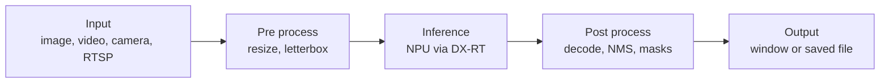

# DX-APP overview

DX-APP is our set of ready to run C++ and Python example applications that run compiled `.dxnn` models on a DEEPX NPU through DX-RT.

You can use it two ways: run the examples as they are to see a model working on your hardware, or copy one as the starting point for your own application. The source is on GitHub at [DEEPX-AI/dx_app](https://github.com/DEEPX-AI/dx_app).

## What you get

| Item | What it is |
|---|---|
| 497 model examples | One example per model variant, across 29 AI tasks such as detection, classification, segmentation, pose, depth, super resolution and re-identification. See the [model catalog](models.md). |
| C++ and Python | Every variant has a C++ example (sync and async) and a Python example (sync, async, and both again with C++ post processing). |
| Multi model graph | `multi_model_graph_sync`, `multi_model_graph_async` and the Python module `dx_graph` run several models on one input from a JSON graph file. See [Multi model graph](multi-model-graph.md). |
| `dx_postprocess` | A Python module that runs our C++ post processing (NMS, box decoding, masks) from Python. See [Post processing](post-processing.md). |
| Demo scripts | `run_demo.sh` runs 26 demo tasks from a menu, `run_multi_model_demo.sh` runs the sample graphs. |
| Developer tools | `scripts/dx_tool.sh` adds, validates, runs and benchmarks examples. See [DX tool](dx-tool.md). |

DX-APP 3.3.0 is part of DEEPX SDK 2.5.0 and needs DX-RT 3.5.0 or later:
| Component | Version in DEEPX SDK 2.5.0 |
|---|---|
| DX-COM (compiler) | 2.5.0 |
| DX-RT (runtime) | 3.5.0 |
| DX-APP (application examples) | 3.3.0 |
| DX-Stream (GStreamer plugins) | 3.2.0 |
| NPU driver | 2.7.0 |
| Firmware | 2.7.6 |
| DX-ModelZoo | 1.0.0 |
| DX AI Studio | 0.1.1 |
## How an example works

Every example runs the same pipeline. Only the factory that picks the pre processor, post processor and visualizer changes from model to model.

* **Sync** examples run the stages one after another for each frame. Use them to learn and to debug.
* **Async** examples overlap the stages: while the NPU runs frame N, the CPU prepares frame N+1 and post processes frame N-1. Use them for the highest FPS on video and streams.

Each run ends with a performance summary: the latency of each stage (read, pre process, inference, post process, display) and the end to end FPS. Use it to find the bottleneck. If Python post processing is the slowest stage, switch to the `*_cpp_postprocess.py` variant of the same example.

## The four Python variants

| Script | Post processing | Threading | Use it for |
|---|---|---|---|
| `<variant>_sync.py` | Python | Sync | Learning and debugging |
| `<variant>_async.py` | Python | Async | Better throughput |
| `<variant>_sync_cpp_postprocess.py` | C++ (`dx_postprocess`) | Sync | Heavy post processing |
| `<variant>_async_cpp_postprocess.py` | C++ (`dx_postprocess`) | Async | Highest FPS |

The C++ examples are `bin/<variant>_sync` and `bin/<variant>_async`.

## Where to go

* [Build DX-APP](build.md): install the dependencies, download models and build with `build.sh`.
* [Run the examples](run-examples.md): the demo script, every command line option, and the test suites.
* [Model catalog](models.md): all 497 variants by task, and how to run any of them.
* [Multi model graph](multi-model-graph.md): several models on one input, with zones, counting and events.
* [Post processing](post-processing.md): the C++ library and the `dx_postprocess` Python bindings.
* [Architecture](architecture.md): repository layout, the shared `common/` layer and how examples are built.
* [DX tool](dx-tool.md): add, validate, run and benchmark examples.
* [Customize a YOLO model](customize-yolo.md): bring your own YOLO model into DX-APP.
* [Third party licenses](licenses.md): licenses of the sample models and data.

## Next steps

* [Install the DEEPX SDK](../../get-started/install.md) if the NPU driver and DX-RT are not installed yet.
* [Build DX-APP](build.md) and run your first example.
