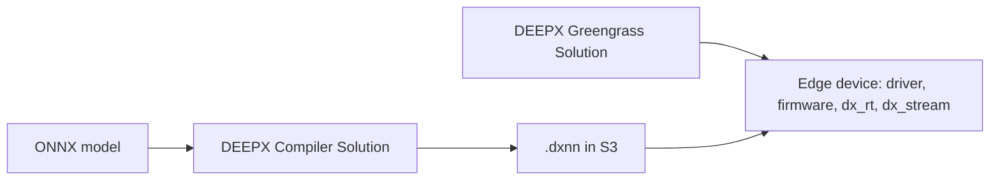

# DX-Edge

DX-Edge is our AWS native path from a trained ONNX model to a DEEPX NPU in the field: you compile on AWS and install the runtime on devices over the air with AWS IoT Greengrass.

| Track | What it does | Delivered as |
|---|---|---|
| **DEEPX Compiler Solution** | Compiles ONNX to `.dxnn` on AWS, either on an EC2 instance you drive or through an event driven S3, Lambda and Step Functions pipeline | AMI on [AWS Marketplace](https://aws.amazon.com/marketplace/pp/prodview-ev6ed5omu4ulo) |
| **DEEPX Greengrass Solution** | The same cloud compile pipeline, plus over the air install of the NPU driver, firmware, `dx_rt` and `dx_stream` on edge devices (zero touch provisioning) | CloudFormation stack on [AWS Marketplace](https://aws.amazon.com/marketplace/pp/prodview-732s46qfzuh34) |
| **Greengrass devices** | DX-AIPlayer N97 and DX-M1 Raspberry Pi 5 kit, both AWS Qualified Devices for Greengrass | [Greengrass devices](dx-edge-devices.md) |



The Greengrass Solution includes the compile pipeline, so it is the single stack option. Choose the Compiler Solution when you only need compilation and manage device runtimes yourself. You can also drive both from [DX Cloud in DX AI Studio](../ai-studio/cloud-aws.md).

You pay for the AWS resources you use. See each Marketplace listing for software pricing and terms. AWS services used: CloudFormation, S3, Lambda, Step Functions, EC2, Systems Manager, CloudWatch Logs, IoT Core and IoT Greengrass V2.

## Before you start

* An AWS account with permission to launch EC2 instances or create CloudFormation stacks.
* The AWS CLI configured on your machine (`aws configure`, then check with `aws sts get-caller-identity`).
* An ONNX model and its JSON compile config. Our model zoo publishes a validated config for each model (see [DX-ModelZoo](../model-zoo/index.md)).
* An existing VPC and subnet with outbound HTTPS to S3, Systems Manager and CloudWatch Logs. A private subnet needs a NAT gateway or VPC endpoints.

## Compile config

The config describes the input shape, calibration and preprocessing. A config with only `inputs`, `calibration_num` and `calibration_method` fails because `preprocessings` is missing, so start from the model zoo config. Example for a 640×640 detector:

```json
{
  "inputs": {
    "input.1": [1, 3, 640, 640]
  },
  "calibration_num": 100,
  "calibration_method": "ema",
  "default_loader": {
    "dataset_path": "/opt/dx-compiler/calibration_dataset/calibration_dataset",
    "file_extensions": ["jpeg", "jpg", "png", "JPEG"],
    "preprocessings": [
      {"resize": {"mode": "pad", "size": 640, "pad_location": "edge", "pad_value": [114, 114, 114]}},
      {"convertColor": {"form": "BGR2RGB"}},
      {"transpose": {"axis": [2, 0, 1]}},
      {"div": {"x": 255.0}},
      {"expandDim": {"axis": 0}}
    ]
  }
}
```

| Key | Meaning |
|---|---|
| `inputs` | Input tensor names and shapes; must match the ONNX model |
| `calibration_num` | Number of calibration images |
| `calibration_method` | Calibration algorithm, for example `ema` |
| `default_loader.dataset_path` | Calibration images. On the AMI they are in `/opt/dx-compiler/calibration_dataset/calibration_dataset`. The CloudFormation pipeline replaces this value automatically. |
| `default_loader.preprocessings` | Must match the preprocessing used in training |

For all config keys, see the [DX-COM section](../compiler/index.md).

## DEEPX Compiler Solution on EC2

Use this for interactive work and repeated option changes. The AMI has DX-COM and a calibration dataset preinstalled under `/opt/dx-compiler`.

1. On the Marketplace page, choose **View purchase options** and subscribe. On **Launch DEEPX Compiler Solution**, choose **Amazon EC2**, then **One-click launch from AWS Marketplace** (or **Launch from EC2 Console** for full control). Fill in version, region, instance type (`t3.xlarge`, 4 vCPU and 16 GiB, is recommended), VPC, subnet, security group and key pair, then **Launch**. Allow only the SSH access you need.
1. Connect and activate the compiler environment:

    ```bash
    ssh -i <your-key>.pem ubuntu@<instance-address>
    source /opt/dx-compiler/venv/bin/activate
    ```

1. Get a model and its model zoo config, and point the config at the bundled calibration data:

    ```bash
    curl -fLO https://sdk.deepx.ai/modelzoo/onnx/yolov5-s-face_640x640.onnx
    curl -fLO https://sdk.deepx.ai/modelzoo/q-lite-json/2_4_0/yolov5-s-face_640x640.json
    sed -i 's#"dataset_path": *"[^"]*"#"dataset_path": "/opt/dx-compiler/calibration_dataset/calibration_dataset"#' \
        yolov5-s-face_640x640.json
    ```

1. Compile. `-o` is an output folder; the `.dxnn` is written inside it, named after the model:

    ```bash
    dxcom -m yolov5-s-face_640x640.onnx \
          -c yolov5-s-face_640x640.json \
          -o output/yolov5-s-face_640x640
    ls -lhR output/
    ```

1. Copy the result to S3 if devices need it, then **terminate the instance** to stop charges:

    ```bash
    aws s3 cp output/yolov5-s-face_640x640/yolov5-s-face_640x640.dxnn s3://<your-bucket>/<path>/
    ```

The Marketplace page also mentions a shorter `dx-compile <model.onnx>` command. Its config and output rules are not documented, so we use `dxcom` with explicit arguments. Compare with `dxcom -h` and `dx-compile --help` on the instance.

## Cloud pipeline (CloudFormation)

Use this for repeatable, hands off compilation. Both products can deploy it; with the Greengrass Solution it comes with the device runtime deployment.

### How it works

1. You upload the `.onnx` and `.json` to the **same path** in the model bucket.
1. An S3 event calls a Lambda function, which continues only when both files are present. The execution name is a hash of the file names, which prevents duplicate runs.
1. A Step Functions workflow launches an EC2 instance from the compiler AMI in your VPC and subnet.
1. Systems Manager Run Command runs `dxcom`. `dataset_path` is replaced with the AMI's calibration dataset.
1. The `.dxnn` is written next to the source model. The workflow terminates the instance on success and failure. Logs go to the CloudWatch log group `/dx-compiler/<stack-name>/execution`.

### Deploy the stack

1. In AWS Marketplace, subscribe to the product, choose the region and **Launch with CloudFormation**.
1. Fill in the parameters:

    | Parameter | Meaning |
    |---|---|
    | `ImageId` | SSM parameter path of the compiler AMI. Keep the default; it resolves per region. |
    | `ModelBucketName` | S3 bucket for ONNX inputs and `.dxnn` results; must be globally unique |
    | `InstanceType` | Compiler instance type (default `t3.xlarge`) |
    | `VpcId` / `SubnetId` | Existing VPC and subnet with outbound HTTPS to AWS services |
    | `ThingGroupName` | (Greengrass Solution) IoT thing group for runtime deployment. Blank creates `<stack-name>-cores`. A name you enter becomes the name of a **new** group the stack creates; it does not import an existing group, and a name that already exists can make creation fail. |

1. Choose **Next**, then **Submit**. When the stack is complete, note the outputs `ModelBucketName`, `StateMachineArn` and `CompilerExecutionLogGroupName`.

### Compile through the pipeline

```bash
export STACK_NAME=<cloudformation-stack-name>
export MODEL_BUCKET=$(aws cloudformation describe-stacks \
  --stack-name "$STACK_NAME" \
  --query "Stacks[0].Outputs[?OutputKey=='ModelBucketName'].OutputValue" \
  --output text)
export MODEL_PREFIX=models/yolov5-s-face_640x640

aws s3 cp --only-show-errors yolov5-s-face_640x640.onnx "s3://${MODEL_BUCKET}/${MODEL_PREFIX}/"
aws s3 cp --only-show-errors yolov5-s-face_640x640.json "s3://${MODEL_BUCKET}/${MODEL_PREFIX}/"
```

Use one prefix per model so configs of different models do not mix. Follow the workflow and logs:

```bash
export STATE_MACHINE_ARN=$(aws cloudformation describe-stacks \
  --stack-name "$STACK_NAME" \
  --query "Stacks[0].Outputs[?OutputKey=='StateMachineArn'].OutputValue" \
  --output text)
aws stepfunctions list-executions \
  --state-machine-arn "$STATE_MACHINE_ARN" \
  --max-results 5 \
  --query "executions[].[status,startDate,stopDate,name]" \
  --output table

export COMPILER_LOG_GROUP=$(aws cloudformation describe-stacks \
  --stack-name "$STACK_NAME" \
  --query "Stacks[0].Outputs[?OutputKey=='CompilerExecutionLogGroupName'].OutputValue" \
  --output text)
aws logs tail "$COMPILER_LOG_GROUP" --since 1h --follow

aws s3 ls "s3://${MODEL_BUCKET}/${MODEL_PREFIX}/"
```

```text
yolov5-s-face_640x640.onnx
yolov5-s-face_640x640.json
yolov5-s-face_640x640.dxnn
```

## Deploy the runtime with Greengrass

The Greengrass Solution stack publishes the component `com.deepx.dx-runtime` and deploys it to the stack's thing group. On each core device it installs, in order:

* the NPU Linux driver (built with DKMS for the device's kernel),
* the DX-M1 firmware (updated with `dxcli`),
* `dx_rt`, the DEEPX runtime,
* `dx_stream`, the GStreamer pipeline plugins.

When the group has core devices, the deployment starts automatically. Zero touch provisioning here means automatic runtime install on devices already registered with AWS IoT Core; certificate injection at manufacturing or fleet provisioning needs its own design. To register a device first, see [Greengrass devices](dx-edge-devices.md).

1. In the Greengrass console, check that the deployment status is **Completed**.
1. If a device has a problem, read the component log:

    ```bash
    # Classic Greengrass nucleus
    sudo tail -f /greengrass/v2/logs/com.deepx.dx-runtime.log
    # Greengrass nucleus lite
    sudo journalctl -f -u ggl.com.deepx.dx-runtime.service
    ```

Install time depends on the device and network. On small arm64 devices that build libraries from source, it can take tens of minutes. To roll out a new runtime version, raise the component version and create a new deployment for the group.

### Verify on the device

```bash
dxcli -s
```

Set the DX-Stream paths and check the plugin:

```bash
GST_ARCH_TRIPLET="$(gcc -dumpmachine 2>/dev/null || true)"
if [ -z "$GST_ARCH_TRIPLET" ]; then
  case "$(uname -m)" in
    x86_64) GST_ARCH_TRIPLET="x86_64-linux-gnu" ;;
    aarch64|arm64) GST_ARCH_TRIPLET="aarch64-linux-gnu" ;;
    *) GST_ARCH_TRIPLET="$(uname -m)-linux-gnu" ;;
  esac
fi
GST_PLUGIN_DIR="/usr/local/lib/$GST_ARCH_TRIPLET/gstreamer-1.0"
export GST_PLUGIN_PATH="$GST_PLUGIN_DIR:$GST_PLUGIN_PATH"
export LD_LIBRARY_PATH="$GST_PLUGIN_DIR:/usr/local/share/gstdxstream/lib:$LD_LIBRARY_PATH"
export PATH="/usr/local/share/gstdxstream/bin:/usr/local/bin:$PATH"
gst-inspect-1.0 dxstream
```

The stack deploys the runtime only. Copy a compiled model to the device yourself (or build your own Greengrass component that carries it) and run a test pipeline:

```bash
aws s3 cp "s3://${MODEL_BUCKET}/${MODEL_PREFIX}/yolov5-s-face_640x640.dxnn" .
curl -fSLO https://sdk.deepx.ai/res/video/sample_videos.tar.gz
tar xzf sample_videos.tar.gz
export MODEL_PATH="$PWD/yolov5-s-face_640x640.dxnn"
export INPUT_VIDEO_PATH="$PWD/dance-group.mov"

gst-launch-1.0 urisourcebin uri=file://$INPUT_VIDEO_PATH ! decodebin ! \
  dxpreprocess preprocess-id=1 resize-width=640 resize-height=640 ! \
  queue max-size-buffers=1 ! \
  dxinfer preprocess-id=1 inference-id=1 model-path=$MODEL_PATH ! \
  queue max-size-buffers=1 ! \
  dxpostprocess inference-id=1 \
  library-file-path=/usr/local/share/gstdxstream/lib/libpostprocess_yolov5s_face.so \
  function-name=PostProcess ! \
  queue max-size-buffers=1 ! dxosd ! \
  videoconvert ! fpsdisplaysink sync=false
```

The post processing library is model specific. For another model, change `library-file-path` together with `model-path`. See the [DX-Stream section](../stream/index.md) for the elements.

## Cost

* **EC2:** the pipeline runs the compiler instance only during a job. An instance you launch yourself runs until you terminate it. EBS volumes cost extra.
* **S3, Lambda, Step Functions, CloudWatch Logs:** storage, events, workflow runs and log retention.
* **IoT Core and Greengrass:** device connections and deployments.

Estimate costs with the AWS Pricing Calculator before you deploy.

## Troubleshooting

| Symptom | What to check |
|---|---|
| The workflow does not start after an upload | Both `.onnx` and `.json` must be in the **same S3 path**; with only one, the trigger waits |
| The workflow fails | The `dxcom` logs in `/dx-compiler/<stack-name>/execution` |
| The instance does not launch | Outbound HTTPS from the subnet (NAT gateway or VPC endpoints) and a completed Marketplace subscription |
| `dxcom: command not found` | Run `source /opt/dx-compiler/venv/bin/activate` first |
| `GPU device discovery failed` warning | Harmless: the instance has no GPU and ONNX Runtime falls back to CPU |
| Compile fails with a hand written config | `preprocessings` is probably missing; use the model zoo config |
| Calibration images not found | `dataset_path` must be `/opt/dx-compiler/calibration_dataset/calibration_dataset`, not the parent folder |
| Input shape error | `inputs` names and shapes must match the ONNX model |
| Accuracy lower than expected | `preprocessings` must match training, and `calibration_num` must be large enough |

## Clean up

1. **EC2:** terminate the instance and delete any EBS volumes left behind.
1. **Stack:** delete it in the CloudFormation console. The model bucket is kept (Retain policy, with versions); empty and delete it yourself if you no longer need it. The thing group the stack created is removed with it; deleting it can need the group membership cleared first.
1. **Devices:** deleting the stack does not uninstall software on devices. Revise the Greengrass deployment to remove the component.
1. **Subscription:** cancel it in AWS Marketplace, Manage subscriptions, when you no longer need it.

For support, contact tech_support@deepx.ai.

## Next steps

* [Set up a Greengrass device](dx-edge-devices.md)
* [Use DX Cloud in DX AI Studio](../ai-studio/cloud-aws.md)
* [Compile locally with DX-COM](../compiler/index.md)
