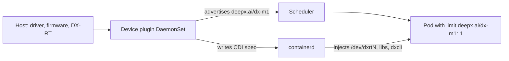

# Kubernetes

This page shows you how to run DX-M1 NPUs as a Kubernetes resource: a pod asks for `deepx.ai/dx-m1: 1` and the scheduler places it on an NPU node with the device and runtime libraries injected.

## How it fits together

| Part | Role |
|---|---|
| [dx-k8s-device-plugin](https://github.com/DEEPX-AI/dx-k8s-device-plugin) 0.1.0 | A DaemonSet on each NPU node that advertises `deepx.ai/dx-m1`, health checks each card and allocates one whole card per request |
| CDI spec (written by the plugin to `/etc/cdi/deepx.json`) | Tells containerd to inject `/dev/dxrtN`, the host runtime libraries and `dxcli` into the pod |
| NFD (node feature discovery) | Labels NPU nodes: presence, count, product, firmware and driver versions |
| `dx-npu` Helm chart (chart 0.2.0, app 0.1.0) | Installs all of the above in one command, from GHCR |
| Metrics | `deepx_npu_*` Prometheus metrics on port `9400` |



Three rules:

1. A pod that does not request `deepx.ai/dx-m1` gets no NPU.
1. One card belongs to one pod at a time. Extra requests wait as `Pending`.
1. If the device plugin stops, the cards disappear from the node's allocatable resources until it is back.

## Before you start

* A Kubernetes cluster with `kubectl` and `helm`. We test on k3s.
* On each NPU node: the NPU driver, firmware and DX-RT. See [Install the DEEPX SDK](../get-started/install.md). `dxcli -s` must list the NPU.
* `jq` for the check commands below (`sudo apt-get install -y jq`).
* A `dx-all-suite` checkout for the sample manifests (`deploy/k8s/samples/`).

### Install k3s, kubectl and helm (if needed)

```bash
curl -sfL https://get.k3s.io | sh -
mkdir -p ~/.kube
sudo cp /etc/rancher/k3s/k3s.yaml ~/.kube/config
sudo chown "$USER" ~/.kube/config
echo 'export KUBECONFIG=~/.kube/config' >> ~/.bashrc
export KUBECONFIG=~/.kube/config
curl -fsSL https://raw.githubusercontent.com/helm/helm/main/scripts/get-helm-3 | bash
kubectl get nodes
helm version
```

## 1. Prepare each NPU node

Stop the host runtime service. Each NPU pod runs its own `dxrtd`, and a second `dxrtd` on the same card leaves inference in the pod hanging:

```bash
dxcli -s
sudo systemctl disable --now dxrt.service
```

!!! warning "The node becomes Kubernetes only for the NPU"
    With `dxrt.service` off, host apps that need `dxrtd` do not run on that node.

The CDI spec mounts the host `libdxrt.so.3` and `libonnxruntime.so.1` into every NPU pod, so the node's DX-RT must be the same build as the DX-RT in your pod image (compare `dxcli --version` on the host and in the image).

## 2. Check CDI in containerd

containerd 2.x has CDI on by default (spec folders `/etc/cdi` and `/var/run/cdi`). Check the version:

```bash
sudo k3s ctr version | grep -m1 Version
```

Only containerd 1.7 needs CDI turned on. On k3s, do **not** create a `config.toml.tmpl` that holds only the CDI lines: k3s uses the template instead of its generated config, so all other settings would disappear. Start from the generated file and append:

```bash
cd /var/lib/rancher/k3s/agent/etc/containerd
sudo cp config.toml config.toml.tmpl
sudo tee -a config.toml.tmpl <<'EOF2'
[plugins."io.containerd.grpc.v1.cri".cdi]
  enable_cdi = true
  cdi_spec_dirs = ["/etc/cdi", "/var/run/cdi"]
EOF2
sudo systemctl restart k3s
```

The smoke test in step 4 proves CDI works: `/dev/dxrt0` appears inside the pod.

## 3. Install the chart

```bash
helm install dx-npu oci://ghcr.io/deepx-ai/charts/dx-npu \
  -n dx-system --create-namespace --set nfd.enabled=true
```

Leave `nfd.enabled=false` (the default) if the cluster already runs NFD. Without any NFD, label NPU nodes yourself: `kubectl label node <node> deepx.ai/dx-m1.present=true`.

To install from the `dx-all-suite` checkout instead, fetch the NFD subchart first (Helm checks every declared dependency):

```bash
helm repo add node-feature-discovery https://kubernetes-sigs.github.io/node-feature-discovery/charts
helm dependency build ./deploy/k8s/charts/dx-npu
helm install dx-npu ./deploy/k8s/charts/dx-npu -n dx-system --create-namespace
```

Check that the NPU is schedulable and labelled:

```bash
kubectl get node -o json | jq '.items[].status.allocatable | with_entries(select(.key|test("deepx")))'
kubectl get node -o json | jq '.items[].metadata.labels | with_entries(select(.key|test("deepx")))'
```

```json
{ "deepx.ai/dx-m1": "1" }
{
  "deepx.ai/dx-m1.count": "1",
  "deepx.ai/dx-m1.driver-version": "v2.7.0",
  "deepx.ai/dx-m1.fw-version": "v2.7.6",
  "deepx.ai/dx-m1.pcie-driver-version": "v2.7.0",
  "deepx.ai/dx-m1.present": "true",
  "deepx.ai/dx-m1.product": "M1"
}
```

### Chart values

| Value | Default | Purpose |
|---|---|---|
| `resourceName` | `deepx.ai/dx-m1` | Advertised extended resource |
| `devicePlugin.image.repository` | `ghcr.io/deepx-ai/dx-k8s-device-plugin` | Plugin image |
| `devicePlugin.image.tag` | `""` (the chart `appVersion`) | Plugin image tag |
| `devicePlugin.nodeSelectorLabel` | `deepx.ai/dx-m1.present` | Runs the plugin only on labelled NPU nodes |
| `devicePlugin.privileged` | `true` | Broad access, because health checks open `/dev/dxrtN` through `dxcli` |
| `nodeFeatureRule.enabled` | `true` | Apply the rule that labels nodes with PCI vendor `1ff4` |
| `nfd.enabled` | `false` | Also deploy node feature discovery (chart dependency 0.17.3) |
| `featureFile.enabled` | `true` | Plugin writes an NFD feature file for the count, product and version labels |
| `metrics.enabled` | `true` | Serve `deepx_npu_*` on port `9400` with a headless Service |
| `metrics.serviceMonitor.enabled` | `false` | Create a prometheus-operator ServiceMonitor (interval 30s) |
| `hostPaths.cdiDir` | `/etc/cdi` | Where the CDI spec is written |
| `hostPaths.usrLocal` | `/usr/local` | Host runtime install location |

## 4. Run a workload

### Smoke test

The sample uses plain `ubuntu:24.04`; the NPU and `dxcli` arrive through CDI. Run from the `dx-all-suite` folder:

```bash
kubectl apply -f deploy/k8s/samples/test-pod.yaml
kubectl wait --for=jsonpath='{.status.phase}'=Running pod/dx-m1-test --timeout=120s
kubectl logs dx-m1-test
kubectl delete pod dx-m1-test
```

```text
=== /dev/dxrt* ===
crw-rw-rw- 1 root root 507, 0 ... /dev/dxrt0
=== dxcli -s ===
DXRT v3.5.0
 * Device 0: M1, Accelerator type
 ...
```

### Real inference

The sample `inference-pod.yaml` uses the suite runtime image `ghcr.io/deepx-ai/dx-runtime:ubuntu-24.04`. An init container downloads one model (YoloV7) into an `emptyDir`; the main container starts its own `dxrtd` and runs `dxrun`.

```bash
kubectl apply -f deploy/k8s/samples/inference-pod.yaml
kubectl wait --for=jsonpath='{.status.phase}'=Succeeded pod/dx-m1-inference --timeout=300s
kubectl logs dx-m1-inference -c inference | grep -E "NPU Processing|Latency|FPS" | tail -3
kubectl delete pod dx-m1-inference
```

If the runtime image is not in a registry yet, build and import it from the `dx-all-suite` folder:

```bash
./docker_build.sh --target=dx-runtime --ubuntu_version=24.04
docker tag dx-runtime:ubuntu-24.04 ghcr.io/deepx-ai/dx-runtime:ubuntu-24.04
docker save ghcr.io/deepx-ai/dx-runtime:ubuntu-24.04 | sudo k3s ctr --namespace k8s.io images import -
```

### Your own pod

Any pod becomes an NPU pod with a resource limit:

```yaml
resources:
  limits:
    deepx.ai/dx-m1: 1
```

To run only on nodes with a given firmware, add a node selector on the NFD label. A version that no node has keeps the pod `Pending`:

```yaml
nodeSelector:
  deepx.ai/dx-m1.fw-version: "v2.7.6"
```

!!! note "glibc in the pod image"
    CDI mounts the node's `dxcli` and `libdxrt.so.3` into the pod, so the image needs at least the glibc they were built with. The prebuilt `libdxrt-bin` package needs glibc 2.27 or newer; DX-RT built from source follows the node's glibc (for example `GLIBC_2.38` on Ubuntu 24.04). `ubuntu:24.04` is a safe base. Check the node with `objdump -T /usr/local/bin/dxcli /usr/local/lib/libdxrt.so.3 | grep -o 'GLIBC_[0-9.]*' | sort -uV | tail -1`.

## Metrics

The plugin serves Prometheus metrics on `:9400/metrics` through the headless Service `dx-npu-metrics`:

| Metric | Meaning |
|---|---|
| `deepx_npu_up` | Exporter is up |
| `deepx_npu_device_healthy` | 1 when the card is healthy |
| `deepx_npu_core_temperature_celsius` | Temperature per core |
| `deepx_npu_core_voltage_millivolts` | Voltage per core |
| `deepx_npu_core_clock_mhz` | Clock per core |

A Grafana dashboard is in the `dx-all-suite` checkout at `deploy/k8s/dashboards/dx-npu.json` (import it under **Dashboards, New, Import**).

## Troubleshooting

| Symptom | Cause and fix |
|---|---|
| `deepx.ai/dx-m1` missing from allocatable | Plugin pod not running. Check `kubectl get pods -n dx-system` and that the node has `deepx.ai/dx-m1.present=true`. |
| No `deepx.ai/*` node labels | NFD not installed. Set `nfd.enabled=true`, install NFD, or label the node by hand. |
| Pod `Pending` with `Insufficient deepx.ai/dx-m1` | All cards are taken, or the pod asks for more than exist |
| Pod scheduled but no `/dev/dxrt*` inside | containerd CDI not enabled (step 2) |
| `dxcli` lists no devices on the host | Driver or firmware not installed. Reinstall, then cold boot if device init fails. |
| Card reported unhealthy | Present in sysfs but missing from `dxcli -s`; usually needs a host power cycle. Also check that the plugin image's glibc is new enough. |
| Inference pod stays `Running`, `dxrun` never exits | Host `dxrt.service` is running: `sudo systemctl disable --now dxrt.service` |
| `dxrun: symbol lookup error: undefined symbol` | Node DX-RT and image DX-RT differ; install the same build on both |
| `GLIBC_2.xx not found` | The pod image is older than the host DX-RT; use `ubuntu:24.04` or newer |
| `dxrt service is not running` in your pod | Start `dxrtd &` in the pod command first |
| `ImagePullBackOff` | Check the image name, whether it is published, or import it locally |

## Reference facts

| Item | Value |
|---|---|
| PCI vendor:device | `1ff4:0100` (M1), `1ff4:0110` (M1M), `1ff4:0000` (older firmware) |
| Device node | `/dev/dxrtN`, one per card, char major 507 |
| Enumeration | `ls /sys/class/dxrt/` |
| Resource | `deepx.ai/dx-m1` (whole device) |

## Next steps

* [NPU driver and firmware](../runtime/driver-firmware.md)
* [DX-RT runtime](../runtime/index.md)
