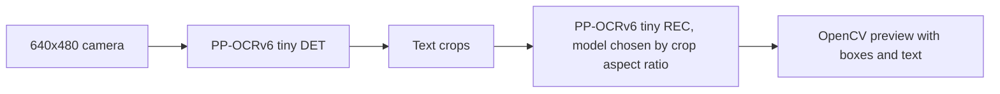

# PP-OCRv6 camera OCR

This demo lets you build a complete OCR pipeline on the NPU and read text live from a camera in Python.

It downloads the PP-OCRv6 tiny detection and recognition ONNX models, fixes their dynamic input shapes, compiles six DXNN models (one detector and five recognizers for different text line widths) and runs a camera app. The notebook is `notebooks/T10-demo-paddleocr/paddleocr_v6.ipynb` in [dx-tutorials](https://github.com/DEEPX-AI/dx-tutorials).



## Before you start

* [Set up the tutorials](setup.md) done: DX-COM, DX-RT with a DEEPX NPU, and `uv`.
* A USB camera and a display for the live app. The `--check` test runs without them.
* About 120 MB of downloads and 15 minutes.

## Steps

1. Start JupyterLab and run `paddleocr_v6.ipynb` from the top:

    ```bash
    cd ~/dx-tutorials
    ./run-jupyter-lab.sh
    ```

    The notebook downloads the models and the calibration data, fixes the shapes, compiles the six models into `notebooks/T10-demo-paddleocr/workspace/outputs/paddleocr_v6` and creates the app environment `workspace/.venv-ocr`.

1. Check that all six models load, without a camera:

    ```bash
    cd ~/dx-tutorials/notebooks/T10-demo-paddleocr/app
    ./run_camera.sh --check --model-dir ../workspace/outputs/paddleocr_v6
    ```

1. Run the live app in a JupyterLab terminal or a desktop terminal:

    ```bash
    ./run_camera.sh --model-dir ../workspace/outputs/paddleocr_v6 \
      --camera /dev/video0 --width 640 --height 480 --fps 15
    ```

    !!! warning
        Always pass `--model-dir`. The app's default folder is `../outputs/paddleocr_v6`, but the notebook writes the models to `../workspace/outputs/paddleocr_v6`.

    Press `q` or `Esc` to exit. `./run_camera.sh --help` lists the threshold options `--det-threshold`, `--box-threshold` and `--rec-threshold`.

## Expected result

The preview window shows a box around each text line with the recognized text.

The recognizer covers Chinese characters and Latin text (6,906 classes). It has no Japanese hiragana or katakana. The bundled `simfang.ttf` font draws the CJK characters; to use another font, pass `--font /path/to/font.ttc` or install `fonts-noto-cjk`.

## Troubleshooting

| What you see | Cause | Fix |
|---|---|---|
| `Application test files are missing` | Not all six models were compiled, or wrong `--model-dir` | Rerun the compile section; pass `--model-dir ../workspace/outputs/paddleocr_v6` |
| `Checksum mismatch` | Interrupted download | Delete the named file under `workspace/models` and rerun the download cell |
| `ModuleNotFoundError: No module named 'dx_engine'` | `.venv-ocr` built with another Python or older DX-RT | Delete `workspace/.venv-ocr` and rerun section 7.1 |
| `Could not open camera /dev/video0` | No camera or no permission | `v4l2-ctl --list-devices`; `sudo usermod -aG video $USER` and log in again |
| Boxes without text | Lighting, focus or thresholds | Tune the three threshold options |

## Next steps

* [PP-OCR web demo](ocr-web-demo.md)
* [Compile models with DX-COM](compiler.md)
* [Tutorials](index.md)
