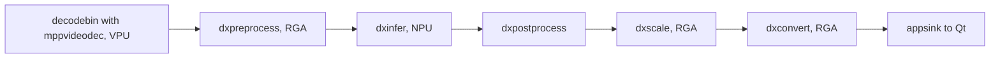

# YOLO26 four channel on RK3588

This demo lets you run YOLO26 detection or instance segmentation on up to four video, RTSP or camera inputs and show them in a 2 x 2 Qt grid.

Both demos are in [dx_demo](https://github.com/DEEPX-AI/dx_demo). They are built only on DX-Stream (GStreamer) and need no OpenCV.

| Demo | Model | Extra |
|---|---|---|
| `yolo26_4ch_demo` | YOLO26 detection (`assets/models/yolo26n-1.dxnn`) | Class panel with a checkbox per class to show or hide its boxes |
| `yolo26seg_4ch_demo` | YOLO26 segmentation (`assets/models/yolo26n-seg.dxnn`) | Masks and boxes drawn in the pipeline by `dxosd` |

Each channel runs one pipeline:



## Before you start

* A Rockchip RK3588 board (for example Orange Pi 5 Plus or Rock 5B) with a DEEPX NPU. The demos use the RK3588 VPU and RGA and do not run on x86.
* DX-RT and DX-Stream installed with `./dx-runtime/install.sh --all`, see [Install](../get-started/install.md).
* A desktop session.

## Steps

1. Check that the DX-Stream plugin and its Python bindings are present:

    ```bash
    gst-inspect-1.0 dxinfer
    ~/dx-all-suite/dx-runtime/dx_stream/venv-dx_stream/bin/python -c "import pydxs"
    ```

1. Get the code and install only the demo parts. Without the skip flags `install.sh` clones `dx-runtime` from its default branch and installs the driver, DX-RT and firmware when `dxrt-cli -s` fails:

    ```bash
    git clone https://github.com/DEEPX-AI/dx_demo.git
    cd dx_demo/yolo26_4ch_demo
    ./install.sh --skip-dxrt --skip-dxstream --runtime-dir=$HOME/dx-all-suite/dx-runtime
    ```

    This installs the Python packages (numpy, PySide6, PyYAML, packaging) and downloads the model and sample videos.

1. Run the demo with your existing SDK:

    ```bash
    ./run_demo.sh --runtime-dir=$HOME/dx-all-suite/dx-runtime
    ```

    The script activates `<runtime-dir>/dx_stream/venv-dx_stream`. You can also set `DX_RUNTIME_DIR` instead of passing `--runtime-dir`. For segmentation, run the same commands in `dx_demo/yolo26seg_4ch_demo`.

## Configuration

Edit `demo/config/yolo26_multich.yaml` (or `yolo26seg_multich.yaml`):

| Key | Values | Meaning |
|---|---|---|
| `model` | path | DXNN model file |
| `engine_backend` | `dxstream` | The only supported backend |
| `dxstream.postprocess_library` | path | For example `/usr/local/share/gstdxstream/lib/libpostprocess_yolo26od.so` (`libpostprocess_yolo26seg.so` for segmentation) |
| `dxstream.color_convert` | `auto`, `rga`, `cpu` | NV12 to RGB with RGA `dxconvert` or CPU `videoconvert` |
| `dxstream.sync_to_fps` | `true`, `false` | Play at the source frame rate, or run flat out for benchmarks |
| `dxstream.display_downscale` | `true`, `false` | Downscale on the RGA to `display_width` x `display_height` (default 960x540) before Qt |
| `dxstream.osd` | `true`, `false` | Segmentation only: draw masks and boxes with `dxosd` |
| `cpu_affinity` | `performance`, `efficiency`, `none` | Pin hot threads to the fast A76 cores (default), the A55 cores, or not at all |
| `render_backend` | `auto`, `gpu`, `cpu` | Draw the 2 x 2 grid with the Mali GPU (OpenGL) or CPU QPainter |
| `channels` | list | Up to 4 entries with `name`, `type` (`video`, `rtsp`, `camera`), `source` and `enabled` |

For `source`, use a file path for `video`, a URL such as `rtsp://user:pass@ip:port/stream` for `rtsp`, and a device index (0, 1, 2) for `camera`.

## Expected result

A 2 x 2 grid plays the four inputs at their native frame rate with boxes or masks. The log shows `decoder: mppvideodec (HW)` when hardware decode is active; `(SW)` means a software fallback.

## Next steps

* [Build a DX-Stream pipeline](dx-stream.md)
* [Platform notes](platform-notes.md)
* [DX-Stream reference](../tools/stream/index.md)
