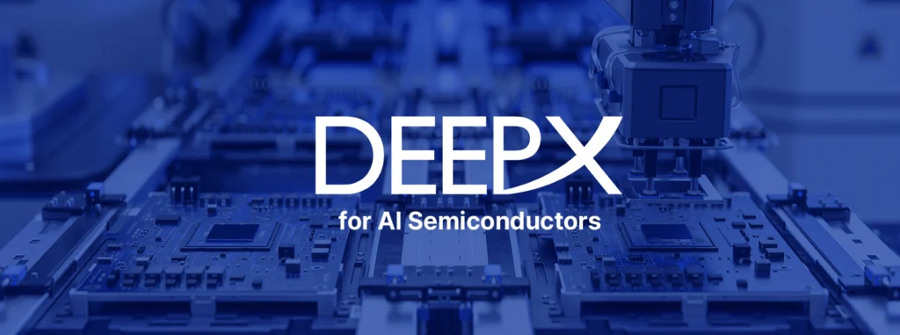
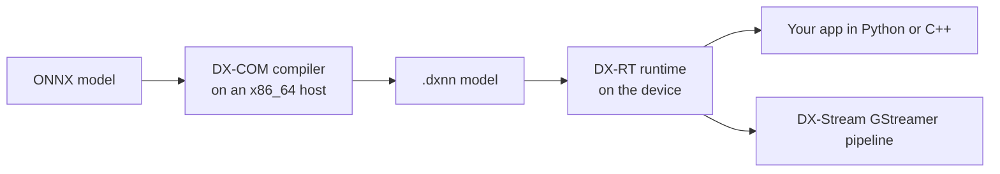

# DEEPX Tech Docs

These docs show you how to take a trained model, compile it for our NPU and run it in your application.

## Start here

| If you want to | Read |
|---|---|
| Understand how the pieces fit together | [Overview](get-started/index.md) |
| Install the SDK on your host and your device | [Install](get-started/install.md) |
| Compile and run your first model | [Quickstart](get-started/quickstart.md) |
| Check which versions work together | [Compatibility](get-started/compatibility.md) |
| Fix a common problem | [Troubleshooting](get-started/troubleshooting.md) |

## How it works

## Tools

| Tool | What it does |
|---|---|
| [DX-COM](compiler/index.md) | Compiles ONNX models into `.dxnn` files for the NPU |
| [DX-RT](runtime/index.md) | Runs `.dxnn` models on the NPU, with Python and C++ APIs |
| [DX-APP](app/index.md) | Ready to run example applications for hundreds of models |
| [DX-Stream](stream/index.md) | GStreamer elements for video pipelines on the NPU |
| [DX-ModelZoo](model-zoo/index.md) | Pretrained models you can compile, run and evaluate |
| [DX AI Studio](ai-studio/index.md) | A desktop app that runs the whole workflow from one window |
| [More tools](tools/index.md) | Benchmark, Kubernetes, DX-Edge and agent driven development |

## Current release

DEEPX SDK 2.5.0, released on 23 October 2026.
| Component | Version in DEEPX SDK 2.5.0 |
|---|---|
| DX-COM (compiler) | 2.5.0 |
| DX-RT (runtime) | 3.5.0 |
| DX-APP (application examples) | 3.3.0 |
| DX-Stream (GStreamer plugins) | 3.2.0 |
| NPU driver | 2.7.0 |
| Firmware | 2.7.6 |
| DX-ModelZoo | 1.0.0 |
| DX AI Studio | 0.1.1 |
See the [release notes](release-notes/index.md) for what changed.

## Next steps

* [Install the SDK](get-started/install.md)
* [Run your first model](get-started/quickstart.md)
* [Help us improve these docs](contributing/index.md)
