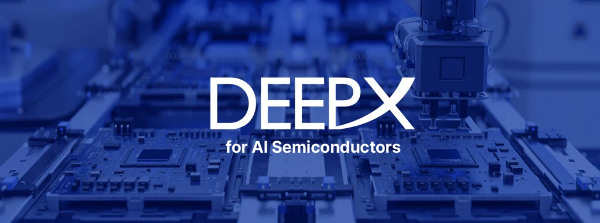
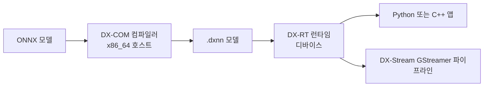

# DEEPX 기술 문서

이 문서는 학습된 모델을 NPU용으로 컴파일하고 애플리케이션에서 실행하는 방법을 안내합니다.

## 시작하기

| 목적 | 문서 |
|---|---|
| 구성 요소 간의 관계 이해 | [개요](../en/get-started/index.md) |
| 호스트 및 디바이스에 SDK 설치 | [설치](../en/get-started/install.md) |
| 첫 번째 모델 컴파일 및 실행 | [빠른 시작](../en/get-started/quickstart.md) |
| 호환되는 버전 확인 | [호환성](../en/get-started/compatibility.md) |
| 일반적인 문제 해결 | [문제 해결](../en/get-started/troubleshooting.md) |

## 작동 방식

## 도구

- :material-cog: **DX-COM**

    ---

    ONNX 모델을 INT8 양자화로 NPU용 `.dxnn` 파일로 컴파일합니다.

    [:octicons-arrow-right-24: 컴파일러](../en/compiler/index.md)

- :material-lightning-bolt: **DX-RT**

    ---

    Python 및 C++ API로 NPU에서 `.dxnn` 모델을 실행합니다.

    [:octicons-arrow-right-24: 런타임](../en/runtime/index.md)

- :material-application: **DX-APP**

    ---

    수백 가지 비전 모델을 위한 즉시 실행 가능한 예제 애플리케이션입니다.

    [:octicons-arrow-right-24: 앱](../en/tools/app/index.md)

- :material-video-input-component: **DX-Stream**

    ---

    NPU에서 실시간 영상 추론 파이프라인을 위한 GStreamer 요소입니다.

    [:octicons-arrow-right-24: 스트림](../en/tools/stream/index.md)

- :material-database: **DX-ModelZoo**

    ---

    즉시 컴파일, 실행 및 평가할 수 있는 사전 학습된 모델입니다.

    [:octicons-arrow-right-24: 모델 주](../en/tools/model-zoo/index.md)

- :material-monitor-dashboard: **DX AI Studio**

    ---

    하나의 창에서 전체 워크플로우를 실행하는 데스크톱 앱입니다.

    [:octicons-arrow-right-24: AI 스튜디오](../en/tools/ai-studio/index.md)

- :material-tools: **추가 도구**

    ---

    벤치마크, Kubernetes, DX-Edge 및 에이전트 기반 개발.

    [:octicons-arrow-right-24: 도구](../en/tools/index.md)

## 현재 릴리스

DEEPX SDK 2.5.0, 2026년 10월 23일 출시.

| 구성 요소 | DEEPX SDK 2.5.0 버전 |
|---|---|
| DX-COM (컴파일러) | 2.5.0 |
| DX-RT (런타임) | 3.5.0 |
| DX-APP (애플리케이션 예제) | 3.3.0 |
| DX-Stream (GStreamer 플러그인) | 3.2.0 |
| NPU 드라이버 | 2.7.0 |
| 펌웨어 | 2.7.6 |
| DX-ModelZoo | 1.0.0 |
| DX AI Studio | 0.1.1 |

전체 버전 매트릭스는 [호환성 페이지](../en/get-started/compatibility.md)를 참조하세요.

## 다음 단계

* [SDK 설치](../en/get-started/install.md)
* [첫 번째 모델 실행](../en/get-started/quickstart.md)
* [문서 개선에 기여하기](../en/contributing/index.md)
