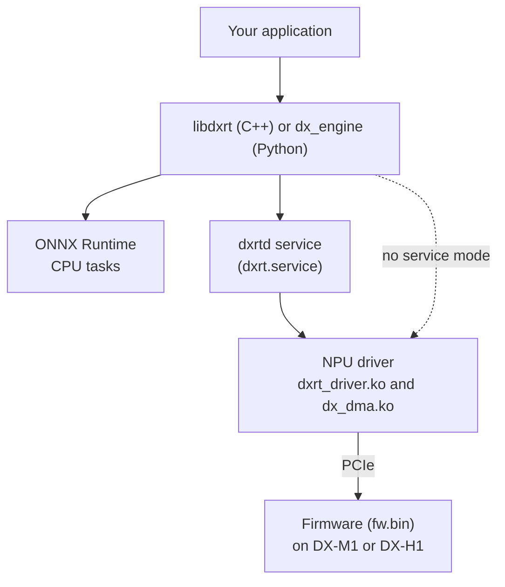

# DX-RT

DX-RT is our runtime for DEEPX NPUs. It loads a compiled `.dxnn` model, sends input to the NPU, runs any CPU tasks with ONNX Runtime and gives you the output tensors. You use it through the C++ library `libdxrt` or the Python package `dx_engine`.

Current version: DX-RT 3.5.0 (DEEPX SDK 2.5.0).

<!-- EDITING NOTE
  The install block below comes from snippets/install-runtime.md. Edit that file, not this page.
  The same snippet is also included in docs/get-started/install.md.
-->
--8<-- "snippets/install-runtime.md"

For Docker and building from source, see the [Install page](../get-started/install.md).

## Where to go

* [Run inference](run-inference.md): sync, async, batch and multi input inference in Python and C++.
* [Configuration](configuration.md): `InferenceOption`, global settings, device status and profiling.
* [Command line tools](cli.md): `dxcli`, `dxrun`, `dxparse`, `dxtop` and `dxbenchmark`.
* [Python API](python-api.md) and [C++ API](cpp-api.md): the full reference.
* [DX-RT examples](tutorials.md): complete example programs.
* [DX-Fit](dx-fit.md): automatic tuning of runtime parameters.
* [NPU driver and firmware](driver-firmware.md): versions, updates, module parameters and Yocto.
* [Build from source](build-from-source.md) and [C# through the C API](csharp.md).
* [Troubleshooting](troubleshooting.md): common errors and fixes.

To install DX-RT, the NPU driver and the firmware, see [Install](../get-started/install.md).

## Architecture

A DX-RT stack has four layers. Your application calls the library. The library talks to the NPU through the `dxrtd` service and the kernel driver. The firmware runs on the NPU itself.

| Layer | What it is | What it does |
|---|---|---|
| Library | `libdxrt.so` (`dxrt.dll` on Windows), `dx_engine` | Loads the model, splits it into NPU and CPU tasks, manages buffers, runs inference |
| Service | `dxrtd`, run by systemd as `dxrt.service` | Shares NPUs between processes and schedules requests from several applications |
| NPU driver | `dxrt_driver` and `dx_dma` kernel modules | Exposes `/dev/dxrt*`, moves data over PCIe with DMA, handles reset and recovery |
| Firmware | `fw.bin` on the device | Runs the NPU cores, reports status and temperature, controls throttling |

The service is on by default (`USE_SERVICE=ON` at build time). You need it when more than one process uses the NPU. See [Build from source](build-from-source.md#build-options) to change this.

## Key concepts

* **Model file**: one `.dxnn` file made by DX-COM. DX-RT 3.5.0 reads file format versions 6 to 9. A model may hold several NPU tasks and CPU tasks.
* **Inference engine**: `InferenceEngine` owns one loaded model. Create it once and reuse it for many inferences.
* **Inference option**: `InferenceOption` picks the devices, the NPU cores, the buffer count and whether to use ONNX Runtime.
* **Data layout**: input and output tensors are NHWC. DX-RT handles device side padding for you.

## Next steps

* [Run inference](run-inference.md)
* [Python API](python-api.md)
* [C++ API](cpp-api.md)
* [Quickstart](../get-started/quickstart.md)
